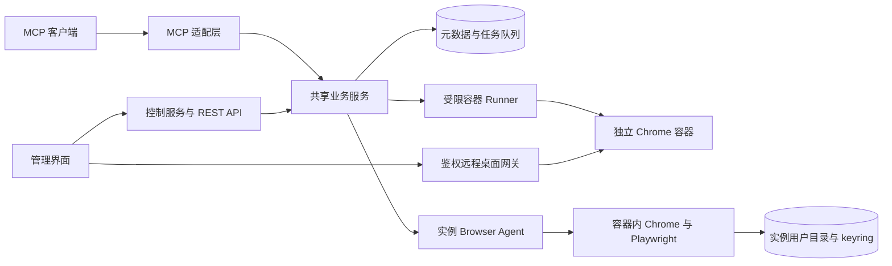

# Chrome Fleet 项目构建提示词

请在 `/opt/chrome-fleet` 中实现 Chrome Fleet：一个自托管的 Chrome 容器管理项目，用来管理多个独立浏览器、长期保存我自己的 Google 和其他网站账号的登录状态，并通过统一 REST API 和 MCP 执行自动化操作。每个容器可以独立设置代理和 VNC 密码；统一管理界面能够创建、查看、启动和关闭容器，并直接跳转到对应容器的远程桌面操作 Chrome。容器支持按需运行，不要求一直启动。目标是先交付能够实际运行的小规模版本，再完成可靠的自动更新与恢复功能。

你是负责交付的资深工程师。请先检查目录、运行环境和适用的项目指令，再设计并实现项目。按下文默认方案推进；普通技术选择自行判断并记录，不要只输出方案就结束。涉及真实账号的首次登录和二次验证，应提供人工接管入口，不要求我把账号密码写进代码或提示词。

## 项目目标和默认范围

- 部署环境是 Linux 单机 Docker Engine 与 Docker Compose，首个版本面向一个管理员、3 至 10 个持久化浏览器实例。这个数量是设计目标，实际并发数根据机器资源配置。
- 每个实例运行真正独立的 Chrome 容器，拥有独立的浏览器进程、用户目录、密钥存储和下载目录。不能用同一浏览器中的多个临时 BrowserContext 冒充容器隔离。
- 默认使用官方 Google Chrome Stable；使用 Playwright 控制。Chrome for Testing 可作为显式配置的替代分发，不能把 Playwright 自带 Chromium 默认为满足 Google Chrome 要求。
- 每个实例可以保存 Google 和其他站点的登录状态，并记录账号别名、站点和期望账号身份。默认一个实例对应一个主要 Google 账号，允许同一实例同时登录不同站点。
- 必须提供统一 Web 管理界面，支持创建和查看 Chrome 容器、手动启动关闭、配置每实例代理及 VNC 密码，以及一键打开实例的 noVNC 远程桌面。
- 支持实例管理、按需启动关闭、人工登录、自动化任务、Cookies 导入导出、站点状态导入导出、完整会话备份恢复、浏览器受控自动更新、REST API 和 MCP。
- 首版提供完整的单机工作流。Kubernetes、多机调度、多人租户、复杂流程设计器、插件市场和浏览器指纹伪装不属于首版要求。
- 网站 Google 登录和 Chrome 浏览器账号登录或 Sync 分开对待；保存网站会话不依赖开启 Chrome Sync。

## 必须遵守的技术边界

### 完整用户目录是会话保存的主要机制

以专用 `user-data-dir` 持久化浏览器状态，容器停止、删除后重建和宿主机重启都不能自动清空它。每个实例只允许一个浏览器进程打开该目录，不能把同一目录读写挂载给多个运行中的实例。[Playwright 持久化浏览器上下文](https://playwright.dev/docs/api/class-browsertype#browser-type-launch-persistent-context)

完整用户目录、Cookies 文件和 Playwright `storageState` 是三种不同能力，分别实现、分别标注恢复范围。Cookies 导入成功只代表 Cookie 写入成功，不能据此宣布目标账号已登录。登录可能过期或被网站撤销，用户目录也不能保证账号永久在线。[Playwright 认证状态说明](https://playwright.dev/docs/auth)

默认支持有界面的 Chrome 和经鉴权的远程桌面。Google 可能拒绝软件自动化控制下的登录，因此首次登录、验证码、2FA 和重新验证由我通过浏览器界面完成；遇到这些情况暂停任务并返回人工接管状态。不能承诺 Google 一定接受自动化登录，也不能靠伪造标志或绕过验证实现需求。[Google 登录浏览器限制](https://support.google.com/accounts/answer/7675428?co=GENIE.Platform%3DDesktop&hl=en)

### 用户目录和 Linux 密钥存储必须一起设计

固定浏览器运行 UID/GID、专用用户目录和 Linux keyring 使用方式。推荐在每个实例内部配置独立的 D-Bus 与 libsecret 或经验证的等价方案，将 keyring 数据和解锁所需配置纳入持久化及恢复流程，解锁秘密由只读 secret 注入。

必须验证容器重建后既有 Cookie 仍能读取，并确认配置没有静默回退到不安全的存储方式。不能把 `--password-store=basic` 当作默认修复方法；Chromium 文档说明该选项使用明文密码存储，指定的存储后端不可用时还可能回退。Profile 文件本身不等于完整的静态加密保护，浏览器工作目录应支持部署在加密磁盘上。[Chromium Linux 密码存储](https://chromium.googlesource.com/chromium/src/+/HEAD/docs/linux/password_storage.md)

不把复制个人电脑的现有 Chrome 用户目录作为默认导入方式；跨操作系统、密钥环境和浏览器版本的迁移可能需要重新登录。

### 自动更新必须可以验证和恢复

自动更新由项目负责定时检查、准备新镜像和逐个替换容器。不能依赖运行容器内部自行升级。Chrome for Testing 本身不自动更新，使用它时仍须实现项目层的版本检查及更新流程。[Chrome for Testing](https://developer.chrome.com/docs/automation-and-testing/chrome-for-testing)

新版 Chrome 可能迁移用户目录。回滚必须恢复匹配的旧镜像和升级前完整用户目录及 keyring 快照，不能让旧版本直接打开已被新版迁移的目录。恢复快照可能舍弃升级后的本地状态，应在更新记录中明确恢复点。[Chrome 回滚时的数据保护](https://support.google.com/chrome/a/answer/9917429?hl=en)

## 推荐技术栈和架构

采用 TypeScript 与实施时仍受支持的 Node.js LTS。推荐 Fastify、Playwright、MCP 官方 TypeScript SDK、Zod 或同类 schema 工具，以及轻量 React 管理界面。使用 workspace 组织代码，提交依赖锁文件。开始实现时核对当前官方文档，锁定实际兼容的 Node.js、Chrome、Playwright、MCP SDK 和协议版本；不要假设本文提到的 API 在任何版本都可用。

首版使用 SQLite WAL 保存元数据、持久化任务队列和租约，数据库放在本机持久卷。通过事务实现状态变更和任务领取，并给迁移留下接口。只有确实需要多进程分布式调度时才引入 PostgreSQL 或 Redis，不要一开始增加一套用不到的基础设施。



组件职责如下：

1. 控制服务负责实例元数据、认证授权、队列、租约、账号绑定、备份、版本管理和 API。REST 与 MCP 共用同一业务逻辑及权限判断。
2. 容器 Runner 只允许创建和操作 Chrome Fleet 标记的容器、批准的镜像、规定目录及网络。请求中不能自由指定宿主路径、特权参数或任意镜像。Docker 管理权限只交给此组件，不能挂进浏览器容器、前端或普通任务执行路径；Docker socket 仍是高权限入口，接口过滤不等于强隔离。
3. Browser Agent 在每个浏览器容器内运行，拥有该实例的唯一长期 Playwright 上下文，负责启动、页面操作、Cookie 读取写入、健康检查和正常退出。私有控制接口需要独立实例凭证，并限制网络访问。
4. Agent 优先使用 `launchPersistentContext` 启动专用用户目录和真实 Chrome，默认 headful。自动化任务必须使用这个已有的持久化上下文，不能每次新建丢失登录状态的匿名 context。
5. 通过 Xvfb、轻量窗口管理器、VNC 和 noVNC 或等价方案提供人工操作入口。远程桌面显示的必须是自动化正在管理的同一个浏览器，实例 VNC 密码必须相互独立；管理界面通过经过身份检查的网关跳转到对应容器。
6. MCP stdio 入口作为 API 客户端桥接到控制服务，不自行创建第二套任务队列、数据库或浏览器；Streamable HTTP 可由控制服务集成提供。

若提供 CDP 扩展，默认只在容器内部监听，不发布到公网。Chrome 136 起远程调试默认用户目录的行为已变化，应始终使用专用非默认目录。CDP attach 与 Playwright 原生控制的能力不同，所需功能要单独验证。[Chrome 调试变更](https://developer.chrome.com/blog/remote-debugging-port)、[Playwright CDP 连接](https://playwright.dev/docs/api/class-browsertype#browser-type-connect-over-cdp)

## 数据模型和并发规则

至少设计这些实体，并提供数据库迁移：

| 实体 | 主要字段和职责 |
| --- | --- |
| BrowserProfile | id、名称、标签、镜像 digest、Chrome 与 Playwright 版本、运行模式、资源限制、持久卷引用、代理引用、VNC secret 引用、启动策略、空闲停止策略、期望状态与实际状态、归档状态 |
| ProxyConfig | profileId、enabled、scheme、host、port、认证 secret 引用、bypass、失败策略、配置版本、当前生效版本、最近检测结果 |
| RemoteDesktopConfig | profileId、VNC 后端及认证方式、密码 secret 引用及版本、会话期限；禁止普通读取接口返回密码 |
| AccountBinding | profileId、provider、账号别名、期望身份、登录状态、最近检测时间、检测证据摘要；不默认保存网站密码 |
| Job | id、profileId、类型、参数引用、步骤进度、状态、幂等键、租约、取消标记、时间、结果及错误摘要 |
| Lease | profileId、owner、到期时间、续租时间、fencing token，用于任务、人工接管、备份、恢复和更新的互斥 |
| Artifact | id、profileId、jobId、类型、内部存储引用、大小、创建时间、过期时间、加密信息及访问权限 |
| Snapshot | profileId、Chrome 版本、镜像 digest、格式版本、profile 与 keyring 快照引用、keyring 解锁 secret 版本引用、校验信息和恢复点 |
| UpdateRun | 当前版本、目标版本、阶段、实例进度、快照引用、失败原因、回滚结果 |
| ApiCredential 和 AuditEvent | 平台主体、授权范围、profile 范围、撤销状态，以及脱敏操作记录 |

浏览器生命周期可包含 `stopped / starting / running / stopping / updating / error`。每个账号的认证状态另行建模为 `unknown / authenticated / needs_login / needs_verification / unsupported`，不要把“容器正常运行”当作“所有账号已登录”。

任务至少包含 `queued / running / waiting_for_human / succeeded / failed / cancelled / timed_out / outcome_unknown`。自动化提交之后连接丢失，不能自动认定动作没有发生。

- 同一 profile 的任务串行执行，不同 profile 可并行，支持全局并发上限和实例资源上限。
- 人工接管持有同一套租约，暂停自动化；Cookies 导入、恢复和升级也不能与现有任务交叉执行。
- 租约超时不代表旧 worker 已停止。新持有者接管前必须拒绝旧 fencing token，并核对或停止旧浏览器，避免双写。
- 创建实例、启动停止、提交任务和更新请求支持幂等键；同一键配合不同请求内容返回冲突。
- 已确认无副作用的读取可以有限重试。导航、GET 请求和点击也可能触发副作用，不能仅凭动作名认定安全重试；提交、发消息、支付、删除等步骤默认不自动重放。没有外部幂等机制时，异常恢复返回 `outcome_unknown` 或进入人工检查。
- 控制服务重启后对账实际容器、目录所有权、持久化任务和租约。既有浏览器不能因为控制服务重启就失去所有会话；所有失败必须能查询。

## 浏览器与账号管理功能

- 创建、列出、查看、重命名、打标签、启动、停止、重启和删除实例。
- 普通删除停止并移除运行容器、归档实例，但保留可寻址的 profile 元数据及会话数据；归档实例仍能查询、恢复和显式 purge。彻底清理使用单独操作和明确参数，界面显示影响范围。
- 配置 Chrome 分发、版本策略、时区、语言、窗口大小、headful 或 headless、每实例代理和资源限制。代理凭证使用 secret 引用，不显示到普通列表。
- 显示 Chrome 实际版本、容器与 agent 健康、磁盘占用、CPU 和内存、当前任务、人工接管状态、最近备份和升级结果。
- 使用短时远程桌面会话完成人工登录、验证码与二次验证。禁止把 noVNC 或 VNC 裸端口直接暴露给外部客户端。
- 登录状态检测使用按站点注册的检测器，验证页面、期望账号标识和明确证据；不支持的站点返回 `unknown` 或 `unsupported`。不能仅以存在某个 Cookie 判定身份。
- 自动化执行账号相关任务前检查期望账号，避免 Google 多账号或网站账号切换后操作错误身份。
- 常见任务完成后保留登录状态数据，是否继续运行按实例策略决定。停止实例释放运行资源，再次启动继续使用原用户目录。
- 无头模式和有头模式切换需要受控重启，不承诺两种模式在所有网站上表现相同。

## 每实例独立代理

代理是每个 Chrome 实例的独立配置，不能通过设置一份宿主机全局 `HTTP_PROXY` 实现。创建实例时可以填写代理，实例详情页可以修改、测试或禁用；不配置代理的实例允许直连。不同实例可以使用不同代理，也可以由我明确选择相同代理。

- 至少支持 HTTP、HTTPS 代理的地址、端口、用户名密码，以及无认证 SOCKS5。区分代理自身的协议和目标网站 HTTPS，HTTP 代理也应测试 HTTPS CONNECT。采用 Playwright 或经验证的浏览器启动配置，人工桌面和自动化共用同一浏览器代理。[Playwright 代理配置](https://playwright.dev/docs/network#http-proxy)
- 带认证 SOCKS5 不能只把用户名密码传给 Chrome 就宣称支持；Chrome 原生 SOCKS5 不支持代理认证，需要时实现每实例私有代理适配进程或中继，并单独测试，未实现则明确返回不支持。SOCKS5 也不等于代理全部 UDP 流量。[Chromium 代理支持](https://chromium.googlesource.com/chromium/src/+/HEAD/net/docs/proxy.md)
- 参数至少包括 enabled、scheme、host、port、认证 secret 引用、bypass 和配置版本。用户名密码通过受保护的写入接口保存，普通 API、日志、列表和页面只显示脱敏配置及“已设置”。
- 修改代理在保存后显示“待生效”或实际生效版本。运行实例通过排空任务和受控重启应用新配置，保留完整用户目录；停止实例在下次启动应用。不能写入成功却仍使用旧代理且不提示。
- 连接测试必须由目标实例内的实际浏览器发起，显示 HTTP 和 HTTPS 请求是否成功、耗时、出口 IP 或可用验证信息、最近测试时间及脱敏错误。不能只在控制服务上 curl 一次就报告浏览器代理正常。
- 对停止实例执行代理测试可以按需临时启动，结束后恢复原来停止状态；手动停用的实例需要用户在界面显式发起该测试或允许启动。
- 配置代理时默认不因连接失败自动切回直连；返回可诊断错误。明确限定代理覆盖的是浏览器网页请求，控制服务、VNC 网关和镜像更新不自动经过账号实例的上游代理。DNS、WebRTC、UDP 和 bypass 行为要说明及验证，不能承诺浏览器代理等价于整个容器的透明网络隧道。

## 每实例 VNC 密码和远程桌面

每个容器拥有自己的 VNC 密码，可以在创建时设置，也可以在实例详情页单独重置或修改；未填写时生成独立随机密码，不使用所有容器通用的默认密码。生成的密码在创建或重置的受保护 Web 流程中允许一次性查看并保存，普通查询和 MCP 返回仅提供 secret 引用或短时查看句柄。该密码与网站账号密码、keyring 解锁秘密和平台登录密码分离。

- VNC 密码持久化为加密 secret 或引用，以受限文件注入对应容器；不放在 Docker label、命令行、普通环境输出、日志、URL 或前端配置文件中。实例列表只显示“已配置”。
- 选择与 noVNC 兼容的认证方式。若采用传统 VNCAuth，必须明示和校验密码有效长度；传统 vncpasswd 只使用前八个字符，密码文件本身也不提供强加密，不能接受长密码后静默截断。[TigerVNC 密码说明](https://tigervnc.org/doc/vncpasswd.html)
- 默认 noVNC 跳转后由用户输入该实例 VNC 密码。平台登录和 profile 权限仍要在网关检查，VNC 密码不是平台访问权限的替代物。
- 每个实例提供稳定的受保护桌面入口，例如 `/profiles/{id}/desktop`；实际 WebSocket 转发由网关根据 profile 和人工会话解析，不把容器内部 IP 和裸 5900 端口作为跳转链接。支持内嵌和新标签打开。[noVNC 项目说明](https://novnc.com/info.html)
- 修改密码应展示生效状态，及时重新加载密码文件或受控重启 VNC 服务；至少新的连接拒绝旧密码，默认撤销该实例既有桌面会话。只修改 VNC 配置不能删除浏览器 profile 或影响其他实例。
- 错误密码、实例未就绪、连接超时和会话过期提供明确界面反馈。会话关闭或过期时网关撤销连接并释放人工操作租约，VNC 后端不能绕过网关继续操作。

## 按需运行和手动启动关闭

实例配置、持久化数据和正在运行的容器是三个不同概念。创建实例默认保存配置和数据目录，初始为 `stopped`；不必马上启动 Chrome，也不占用长期浏览器进程资源。

- 每实例提供 `on_demand / manual / always` 启动策略，默认 `on_demand`。管理界面始终允许手动启动、关闭和重启，并显示实际状态、过渡状态及失败原因。
- `on_demand` 在提交任务或打开桌面时启动实例，等待 agent、Chrome 和所需 VNC 服务就绪后再继续。多个并发唤起请求应合并为一次启动，不能重复创建容器。
- `manual` 模式的停止实例不被后台任务自动启动；返回 `PROFILE_STOPPED` 和可操作的启动入口。`always` 模式只对未被手动停用的实例维持运行。
- 手动关闭可以标记“暂停自动唤起”，默认保留到我手动启动或重新允许自动唤起，防止后台任务或重启策略立即把刚关闭的实例拉起。界面展示该状态。
- 支持配置空闲自动关闭，默认空闲 15 分钟，也可禁用。空闲的定义排除排队和运行任务、有效人工会话、下载、备份、更新及恢复；不能只因为鼠标不动就关闭。
- 正常关闭先停止领取新任务，再排空当前任务、释放桌面、关闭 Chrome 和 keyring 后停止容器。忙碌时返回等待状态或冲突，不能直接杀进程；强制关闭作为显式参数，保留取消或结果未知状态。
- 正常关闭不删除用户目录、keyring、代理配置、VNC 密码和账号绑定。应验证持久性 Cookies 的保存；会话型 Cookie 和网站服务端过期策略不能被当作永久状态。
- 手动停止、启动策略和空闲策略持久化。宿主机或控制服务重启后遵循这些策略，不能对所有浏览器配置无条件 restart-always。
- 停止实例的浏览器版本标注为“上次运行版本”，不能假装它实时在线。更新服务先准备目标镜像，停止实例在下次按需启动前执行必要的备份与迁移验证；不能仅为了例行版本检查把所有停止实例唤起。

## 自动化任务设计

提供有版本的声明式任务 schema，以 Playwright 为执行引擎，优先支持：

- 打开或切换页面、导航、等待页面或元素、按 role、label、text 或 CSS 定位。
- 点击、输入、键盘操作、下拉选择、上传指定 artifact、读取指定内容和截图。
- 下载文件、读取下载结果、等待弹窗、指定 iframe 和基本断言。
- 保存任务模板，提交任务、查看进度、取消任务、查询脱敏日志和获取结果 artifact。

每个步骤有明确超时、成功条件、结果大小限制和重试属性；每个任务有总时限。优先使用 Playwright 的等待机制和稳定定位，不靠一串固定 sleep。

首版不通过对外开放任意 Node.js、shell、`eval` 或任意宿主文件路径来实现自动化。需要扩展时使用管理员注册的任务模板和明确参数 schema；页面内脚本能力应单独授权，不能与宿主代码执行混为一谈。

下面的任务格式是建议契约，可以在实现时合理调整，但必须同步更新 API、MCP、SDK 和文档：

```json
{
  "profileId": "profile_demo",
  "idempotencyKey": "demo-read-title-001",
  "timeoutMs": 60000,
  "steps": [
    { "action": "goto", "url": "https://example.com" },
    { "action": "waitFor", "locator": { "css": "h1" } },
    { "action": "extractText", "locator": { "css": "h1" }, "resultKey": "title" },
    { "action": "screenshot", "fullPage": false }
  ]
}
```

取消应协作执行并释放租约。若副作用已经发生，取消状态和结果应保留已执行步骤，不能声称回滚了网站操作。超时、浏览器崩溃和人工接管都应保存可恢复的进度信息。

## Cookies 和站点状态导入导出

### Cookies

主格式使用带 `schemaVersion`、导出时间、浏览器版本和作用域的 JSON。支持按 URL 或精确域名范围导出当前实例的 Cookies，包含 HttpOnly Cookies；必须通过所管理浏览器的 Playwright 或受控 CDP API 读取，不能抓取宿主机其他浏览器数据或自行解密其数据库。

保留 `name / value / domain / path / expires / httpOnly / secure / sameSite` 以及运行版本支持的 `partitionKey`。明确定义过期时间单位、会话 Cookie、host-only 语义、域和子域匹配、SameSite 约束及字段兼容处理，不能静默丢弃关键属性。[Playwright Cookies API](https://playwright.dev/docs/api/class-browsercontext#browser-context-cookies)

导入需要 profile 写锁，并校验文件大小、格式版本、字段、Cookie 作用域和授权范围。提供合并与明确范围内替换两种模式、预检结果以及逐项失败报告；不要默认清空实例全部 Cookies。批量应用失败时保留可说明的部分结果，不能假装原子成功。

可提供 Netscape 格式作为兼容输出，明确标注分区属性等信息可能丢失。Cookies 文件默认生成加密 artifact，由 API 提供短时受保护下载；仅有单独的会话导出权限时才能取明文。MCP 普通返回只包含 artifact 标识、数量、作用域和失效时间，不把登录 Cookie 值塞进模型文本。

### Playwright storageState

作为单独的 `storage-state` 类型导出和导入，覆盖 Cookies、localStorage，并在锁定版本支持时显式启用 IndexedDB。实现前核对当前版本的原生恢复 API；若持久化上下文不支持所需恢复方式，应采用经过验证的初始化流程，不能假设 `launchPersistentContext` 接受所有临时 context 参数。[Playwright storageState API](https://playwright.dev/docs/api/class-browsercontext#browser-context-storage-state)

sessionStorage 不由标准 storageState 流程自动保存；若特定站点需要，提供显式按 origin 处理的适配，不承诺通用完整迁移。其他依赖设备绑定、真实 WebAuthn 密钥、服务端状态或扩展的数据不能通过普通 Cookie 或 storageState 文件保证恢复。[Playwright 认证状态范围](https://playwright.dev/docs/auth#session-storage)

### 完整会话快照

完整备份覆盖用户目录、`Local State`、keyring、UID/GID、浏览器版本、镜像 digest 和所需配置引用。记录 keyring 解锁 secret 的版本引用，并确保恢复时该版本可取得；不能把新解锁秘密配到旧 keyring 上。秘密密钥与备份正文分离管理，备份内容加密并校验完整性。

取得维护租约、停止新任务、正常退出 Chrome，再让 keyring 守护进程完成写盘并停止，随后备份，避免在线直接复制 SQLite 文件产生不一致快照。恢复也只能在实例停止时执行；检查兼容性、路径和文件权限。拒绝路径穿越、越界符号链接和恶意压缩包，不能让导入内容覆盖任意宿主文件。

默认禁止克隆已登录 profile；如未来开放克隆，必须说明它会复制账号会话，并确保新实例使用独立目录、恢复流程和锁。

## REST API 契约

使用 `/api/v1` 作为前缀，输出 OpenAPI 文档和 TypeScript 客户端。JSON 成功响应包含 `data` 与 `requestId`，错误响应包含稳定的 `code / message / details / requestId`，敏感值不得进入错误内容。集合支持分页和筛选，长操作返回 HTTP 202 和持久化 `jobId`，幂等冲突或实例被占用返回可处理的错误。

至少实现这些路由，细节可按最终 schema 调整：

| 方法和路径 | 功能 |
| --- | --- |
| GET /health 与 GET /ready | 进程与依赖状态；不泄露内部凭证 |
| GET /api/v1/profiles | 实例列表和筛选 |
| POST /api/v1/profiles | 创建实例配置与独立数据目录 |
| GET PATCH DELETE /api/v1/profiles/{id} | 查看、修改、归档实例并保留可寻址元数据和会话 |
| POST /api/v1/profiles/{id}/unarchive | 恢复归档配置，默认保持 stopped |
| POST /api/v1/profiles/{id}/purge | 明确清理该实例的会话数据 |
| POST /api/v1/profiles/{id}/start 或 stop 或 restart | 幂等生命周期管理 |
| GET PATCH /api/v1/profiles/{id}/runtime-policy | 启动策略、自动唤起和空闲关闭策略 |
| GET PUT DELETE /api/v1/profiles/{id}/proxy | 查看脱敏代理配置、设置或禁用实例代理 |
| POST /api/v1/profiles/{id}/proxy/test | 从目标浏览器测试代理和出口信息 |
| GET /api/v1/profiles/{id}/remote-desktop | 桌面配置状态、入口与密码是否已设置；不返回秘密 |
| PUT /api/v1/profiles/{id}/remote-desktop/password | 设置或轮换该实例 VNC 密码 |
| GET POST /api/v1/profiles/{id}/accounts | 查看或绑定期望账号 |
| POST /api/v1/profiles/{id}/accounts/check | 检测支持的站点登录状态 |
| POST /api/v1/profiles/{id}/manual-sessions | 开始有期限的人工接管并获取受保护入口 |
| DELETE /api/v1/manual-sessions/{sessionId} | 结束人工接管，回收权限和租约 |
| POST /api/v1/jobs | 提交自动化任务或已注册模板 |
| GET /api/v1/jobs 与 GET /api/v1/jobs/{jobId} | 任务列表、进度、结果和错误 |
| POST /api/v1/jobs/{jobId}/cancel 或 resume | 取消或在验证完成后恢复任务 |
| GET /api/v1/jobs/{jobId}/events | SSE 任务事件流，与 MCP 传输分别实现 |
| POST /api/v1/profiles/{id}/cookies/export 或 import | Cookies 导出或导入 |
| POST /api/v1/profiles/{id}/storage-state/export 或 import | 站点状态导出或导入 |
| POST /api/v1/profiles/{id}/snapshots | 停机备份 |
| GET /api/v1/profiles/{id}/snapshots | 备份列表 |
| POST /api/v1/profiles/{id}/restore | 指定快照恢复 |
| POST /api/v1/artifacts 与 GET /api/v1/artifacts/{artifactId} | 上传授权文件、读取元数据；受保护下载另设路径 |
| GET /api/v1/browser-versions | 当前、可用及已验证浏览器版本 |
| GET PATCH /api/v1/update-policy | 查看和配置自动更新策略 |
| POST /api/v1/updates/check 或 apply | 检查更新或创建受控升级任务 |
| GET /api/v1/updates/{updateId} | 查询更新进度 |
| POST /api/v1/updates/{updateId}/rollback | 按匹配镜像和升级前快照回滚 |

路由表中的 `或` 是多个具体路由，不是路径文字。API 客户端只传实例、任务和 artifact 标识，不能绕过控制服务直接指定 Docker ID、内部端口或任意磁盘路径。

## MCP 设计

使用 MCP 官方 SDK，至少支持本地 stdio 与 Streamable HTTP。实现所支持稳定协议版本的初始化、能力声明、工具列出与调用；不要只提供一个伪装为 MCP 的普通 JSON 接口，也不要把旧版 HTTP SSE 接口当成唯一远程支持方式。[MCP 传输规范](https://modelcontextprotocol.io/specification/2025-11-25/basic/transports)

至少提供以下工具，并为每个工具定义参数 schema、结构化输出、错误和权限：

- `profiles_list / profiles_get / profiles_create / profiles_start / profiles_stop / profiles_restart / profiles_runtime_policy_set`
- `profiles_proxy_get / profiles_proxy_set / profiles_proxy_test / profiles_vnc_password_set`
- `manual_session_open / manual_session_close`（账号主动检测已移除，改用实例详情人工确认）
- `jobs_submit / jobs_get / jobs_cancel / jobs_resume`
- `browser_pages_list / browser_navigate / browser_click / browser_fill / browser_extract / browser_screenshot`
- `cookies_export / cookies_import / storage_state_export / storage_state_import`
- `profiles_backup / profiles_restore / artifacts_get`
- `browser_versions_list / browser_updates_check / browser_updates_apply / browser_updates_rollback`

单步浏览器工具也提交到同一套队列并持有 profile 租约，不能绕过任务系统。耗时工具返回 `jobId`，由查询工具读取结果。正确声明只读、破坏性、幂等与开放网络等 annotations；这些声明是客户端提示，实际权限必须在服务端检查。代理和 VNC 密码工具优先接收 secret 引用，不能让助手在对话文本中请求或回显真实密码。

stdio 的 stdout 只写协议数据，日志使用 stderr。HTTP 模式校验 Origin 与 Host，拒绝非法 Origin；默认只通过宿主机 `127.0.0.1` 映射暴露，并要求身份认证。MCP session ID 不是认证凭证。[MCP 传输安全要求](https://modelcontextprotocol.io/specification/2025-11-25/basic/transports)

本地受信任客户端可以配置平台访问凭证；开放远程模式时按照所支持的 MCP 官方授权规范，接入 OAuth 资源服务器、授权服务器发现、PKCE、token audience 与 scopes 校验。不要以固定 API key 方案声称兼容所有远程 MCP 客户端。Google Cookies 或网站 token 不能用作 Chrome Fleet 平台凭证。[MCP 授权规范](https://modelcontextprotocol.io/specification/2025-11-25/basic/authorization)

提供能运行的 stdio 客户端配置和 Streamable HTTP 连接示例。示例中的凭证只用环境变量或 secret 引用，不能写真实秘密。

## 自动更新流程

提供 `manual / notify / auto` 三种策略，默认 `auto` 在可配置维护窗口内执行，仅采用已通过兼容性验证的 Stable 版本。默认每天检查一次，时间按 `Asia/Shanghai` 展示，存储时间使用 UTC。允许暂停更新和固定实例版本。

1. 从官方 Google 软件源或 Chrome for Testing 发布数据检查版本。Google Chrome 与 CfT 的下载、构建和版本发现适配分别实现，不能把 CfT 的任意二进制当成普通 Chrome 安装包。
2. 准备带确定版本和镜像 digest 的新镜像；验证发布源、安装包签名或官方能提供的验证机制及 TLS。若官方没有发布某种校验信息，不能编造“已校验官方 checksum”。失败保留当前镜像。
3. 在一次性空白 profile 上验证 Chrome 启动、sandbox、keyring、Playwright 操作、Cookies 和退出流程，记录实际版本及兼容结果。
4. 对待升级实例设为 draining，停止领取新任务，等待正在运行的任务和人工接管退出；有活动任务时延后，不能强行中断并自动重放。
5. 正常停止 Chrome，制作加密的一致性快照，记录旧镜像与快照配对。备份失败则停止升级。
6. 先升级一个实例，验证容器、浏览器、agent、Cookie 可读取和配置的登录状态检测器，再逐个升级其余实例。准备阶段的空白测试不得使用真实账号 Cookie。
7. 技术健康通过但站点要求重新验证时，标记该账号 `needs_login` 或 `needs_verification` 并提供人工接管；不能无限回滚重试登录或伪装为健康登录。
8. 技术失败时停止新浏览器，保存失败诊断；恢复旧镜像和升级前完整快照，再验证并记录结果。回滚失败保留数据、标记实例错误并展示恢复步骤。
9. 更新任务必须可在控制服务或宿主机重启后继续对账；记录阶段、当前版本、目标版本、恢复点和每个实例结果。

实例原本是 stopped 时，准备镜像并记录待应用版本，不保持容器常驻；下一次显式或按需启动在任务和桌面可用之前完成一致性快照及验证。一次性维护检查结束后恢复原运行策略，不把 stopped 实例变成 always。

禁止用 Watchtower 等工具无条件自动替换所有实例，也禁止对运行容器后台执行不可追踪的 `apt upgrade`。可以自动完成镜像构建，但构建执行与浏览器运行权限隔离。

## 部署与访问控制

- 默认仅宿主机 loopback 开放管理入口，容器内部监听与宿主映射分开配置。远程使用通过配置的 HTTPS 反向代理访问，包含 WebSocket 和 noVNC 认证。
- 使用非 root 浏览器用户，显式开启 Playwright 的 `chromiumSandbox` 或等价 sandbox 配置。不能默认添加 `--no-sandbox`、privileged、host network 或关闭 TLS 校验。[Playwright Docker 运行建议](https://playwright.dev/docs/docker)
- 为 Chrome 设置独立且足够的 `/dev/shm`，避免用共享宿主 IPC 破坏隔离；配置 init、退出宽限期、CPU、内存、进程数及磁盘配额或容量告警。
- 实例间不挂载对方 profile。浏览器容器不挂载 Docker socket、宿主根目录和其他服务的秘密。管理网络与浏览器网页出站访问分开；默认阻止访问控制面、宿主管理接口和云元数据地址，需要内网站点时通过明确配置放行。
- 单机平台凭证支持生成、轮换、撤销、有效期、profile 范围和操作 scopes。至少区分读取、自动化、会话导入导出、备份恢复和更新管理。
- 使用后台凭证时不把它直接写进前端 bundle。Web 界面使用安全会话，Cookie 设置 HttpOnly、Secure 等属性，并对写操作处理 CSRF。
- Cookie、storageState、完整快照、截图、下载、HAR、trace 和页面正文都可能包含敏感内容；默认不记录 Cookie 值、密码、Authorization、完整表单或 URL 中的 token。人工登录期间不自动录屏或截图。
- 导出和备份采用标准认证加密或成熟库，主密钥通过 secret 文件提供，并记录 keyId 与轮换流程；不能自创加密算法。
- Artifact 下载逐次检查主体和 profile 权限，短时句柄不作为永久绕过授权的链接；禁止进入 URL、访问日志和无权限的 MCP 输出。
- `.gitignore` 排除运行目录、Cookies、站点状态、备份、数据库、真实 `.env` 和私钥。只提交脱敏 fixture 与 `.env.example`。
- 审计记录主体、时间、profile、操作、任务、结果和脱敏原因。提供日志与 artifact 保留期限、空间清理和磁盘不足时的可控失败行为。

## 管理界面和开发者体验

统一 Web 管理界面是必交付项。以实例列表为入口，能完成创建、查看、配置代理、设置 VNC 密码、启动关闭和跳转远程桌面的完整流程，不能只交付 API 或 CLI。

- 实例列表显示名称、标签、实际运行状态、启动策略、上次 Chrome 版本、脱敏代理地址、代理生效状态、账号状态、当前任务和最近错误。提供搜索与按状态筛选。
- “创建 Chrome 容器”表单包含名称、账号别名、代理协议及认证设置、VNC 密码、启动策略、空闲自动关闭配置和可选高级参数。默认创建后 stopped，可勾选创建后启动。
- 每一行或卡片提供“启动”“关闭”“重启”“打开桌面”“设置”和“查看任务”。状态变化时正确禁用冲突操作，并通过事件或轮询更新，不要求刷新整个页面。
- “打开桌面”从目标实例跳转到它自己的 noVNC 页面。停止的按需实例先显示启动进度，服务就绪后进入桌面；手动模式或暂停唤起时提供显式“启动并打开桌面”动作。进入后验证该实例 VNC 密码。
- 设置页支持独立编辑代理、测试实际出口、独立设置或重置 VNC 密码、调整运行策略，并显示配置待生效、重启中和已生效状态。
- 实例详情同时提供账号状态、任务提交和结果、Cookies 及站点状态导入导出、备份恢复、更新策略和更新记录。
- 界面明确区分运行正常、登录有效、待人工验证和任务结果未知；关闭实例时说明会保留账号状态数据，不显示内部连接细节作为普通用户流程。

交付 Docker Compose、浏览器与各服务 Dockerfile、配置校验、初始化命令、数据库迁移、OpenAPI、MCP 示例以及故障排查说明。提供 TypeScript SDK 和 curl 示例，并说明 HTTP 202 异步任务的轮询方式。

需要一个环境检查命令，确认架构、Docker、Compose、磁盘、端口、secret、sandbox 与 Chrome 可用性。当前目标优先支持 Linux x86_64；其他架构只有验证官方 Chrome 分发确实可用才标为支持，不能静默换成 Chromium。

推荐代码布局，可以按实现调整：

```text
/opt/chrome-fleet/
  BUILD_PROMPT.md
  README.md
  apps/
    control-plane/
    browser-agent/
    runner/
    mcp-bridge/
    web/
  packages/
    contracts/
    core/
    sdk/
  docker/
    browser/
  docs/
    architecture.md
    operations.md
    api.md
    mcp.md
    session-recovery.md
  tests/
    fixtures/
    integration/
    e2e/
  compose.yaml
  .env.example
  .gitignore
```

运行数据默认位于 `/var/lib/chrome-fleet`，根路径可配置。profile、keyring、数据库、artifact、备份和临时目录分别组织，并限制目录权限；首次部署不能误改 `/opt` 中现有服务。

## 实施顺序

每个阶段都要交付可运行代码和对应验证，发现接口不支持或版本不兼容时解决实际问题并同步文档。

1. 环境检查、架构决策、数据模型、配置与基础鉴权；搭建控制服务、受限 Runner 和单个真实 Chrome 容器，完成独立 VNC 密码、桌面入口以及停止重建后的会话恢复。
2. 扩展到多个独立实例，实现统一管理界面的创建查看、启动关闭和桌面跳转，完成每实例代理、按需启动及空闲关闭；加入持久化任务、租约、人工互斥、声明式自动化和结果 artifact。
3. 实现 Cookies、storageState、完整快照的分离导入导出和恢复，补齐权限、加密、审计及无损字段处理。
4. 接入 MCP stdio 与 Streamable HTTP，复用业务服务、权限与队列；补齐 SDK、OpenAPI 和客户端连接示例。
5. 实现官方版本检查、镜像准备、兼容测试、自动维护窗口、逐实例升级、配对回滚和重启对账；完成部署文档与最终验收。

必须最终完成上述核心能力；如果受运行环境限制而无法验证某项，明确记录阻塞条件、已有交付和可重复的验证命令，不能将空接口或 TODO 宣称为功能完成。

## 验收条件

使用本地可控测试站点模拟认证和失效，自动化测试不依赖真实 Google 账号，也不读取我现有浏览器的数据。测试站点应覆盖服务器撤销登录、HttpOnly Cookies、localStorage、IndexedDB、会话 Cookie 和登录身份检查。重启后的持续登录验收使用未过期的持久性认证 Cookie；会话型 Cookie 按所选 Chrome 会话恢复策略单独验证，不能混作永久持久化保证。

| 场景 | 通过条件 |
| --- | --- |
| 多实例隔离 | 至少 3 个独立浏览器容器拥有不同 profile，同一测试站点登录不同测试账号后，Cookie 与页面身份互不串用 |
| 独立代理 | 至少两个实例配置不同代理，经实际浏览器请求证明分别经过对应代理；更改一个不影响其他实例，错误认证和断网不静默直连，重启后配置仍有效 |
| VNC 独立密码 | 两个实例设置不同密码，新连接拒绝错误密码和另一实例的密码；轮换后旧密码失效，停止重建后配置仍在，普通 API 和日志不包含密码 |
| 统一管理界面 | 在网页完成创建、查看、代理编辑、密码设置、手动启动和关闭，并从实例入口跳转到正确容器的同一个 Chrome 桌面 |
| 按需启动关闭 | 创建默认不运行；任务或显式桌面动作按策略启动一次，手动停止不会立刻被自动拉起；空闲关闭不打断任务或人工会话，再次启动保留 profile |
| 持久化 | 正常停止再启动、删除并重建浏览器容器、重启控制服务后，会话数据仍在，测试账号按预期保持登录；keyring 可读取 |
| 人工接管 | 接管界面控制同一 Chrome；接管期间任务不执行，关闭后按规则恢复；验证码和 2FA 等情况能返回等待人工状态 |
| 账号失效 | 测试服务端撤销会话后检测为需要登录，不因 Cookie 文件存在而显示 authenticated |
| Cookies 往返 | 导出导入后支持字段、HttpOnly、会话期限和分区 Cookie 属性按 schema 保留；格式不兼容和部分失败可查询 |
| 状态和快照 | Cookie、storageState 和完整快照分别验证；停止状态完整恢复后测试认证数据可用；不支持的恢复范围明确显示 |
| 队列和故障恢复 | 同 profile 任务不交叉，不同 profile 能并发；租约失效及控制服务重启不会双开同一用户目录 |
| 副作用不重复 | 用测试站点的计数器动作模拟提交后断线，系统返回结果未知或人工检查，不自动重复提交 |
| API 与 MCP 一致 | REST 和两种 MCP 传输调用相同实例与任务；错误、scope、profile 限制一致，stdio 无日志污染 |
| 自动更新成功 | 测试版本源发现候选版本后自动完成镜像准备、兼容测试、停机快照、单实例试升级和后续逐个升级，实际版本记录准确 |
| 更新与回滚失败 | 用坏镜像或模拟兼容失败证明备份失败会阻止升级、失败升级恢复旧镜像及原快照、不会用旧浏览器打开迁移后的目录 |
| 更新过程重启 | 在不同更新阶段中断控制服务后可以对账恢复，不丢恢复点，不同时启动两个容器占用同一 profile |
| 访问控制 | 无凭证或无 scope 无法访问实例、会话导出、artifact 和桌面；非法 Origin 被拒绝；公网未暴露 CDP、VNC 或 Docker |
| 删除与空间不足 | 归档删除保留可寻址数据，能重新启用和 purge，purge 只影响目标实例；磁盘不足和导入路径攻击可控失败，不损坏其他实例 |
| 可部署交付 | 根据 README 能完成配置、构建、启动、创建实例、人工登录、提交任务、连接 MCP、导出和恢复，不需要补写核心逻辑 |

真实 Google 登录单独列为人工验收：我通过远程桌面登录后，验证同一环境停止重启和容器重建能读取既有会话；若 Google 要求重新验证，正确进入人工处理流程。人工验收尚未执行时，说明未验证，不用本地测试结果声称 Google 登录已验证。

在最终交付中说明实现内容、固定版本、部署和 MCP 连接命令、通过的检查、真实账号人工验收情况，以及仍存在的具体限制。所有文档、错误说明和管理界面默认使用简体中文，代码标识和 API schema 使用统一英文。
