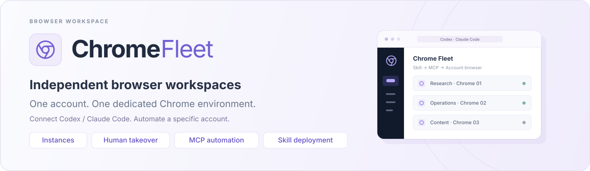
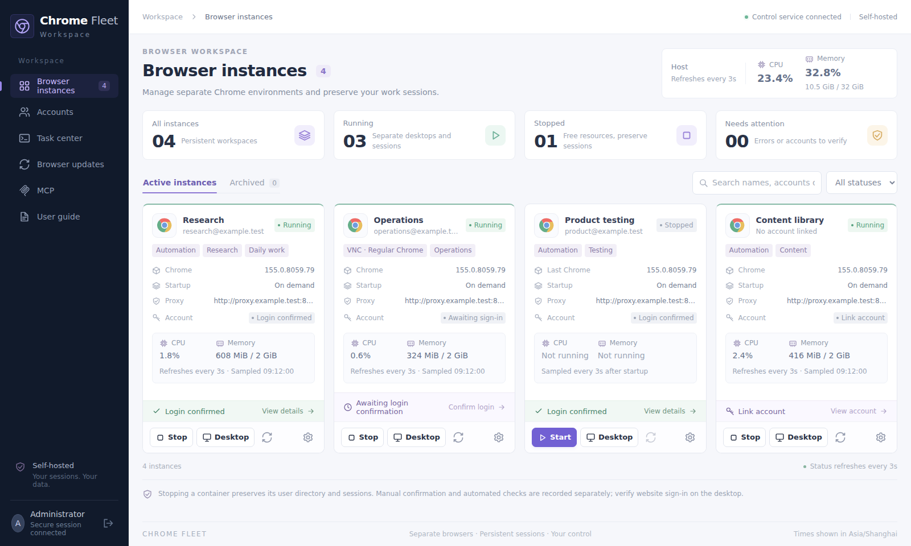
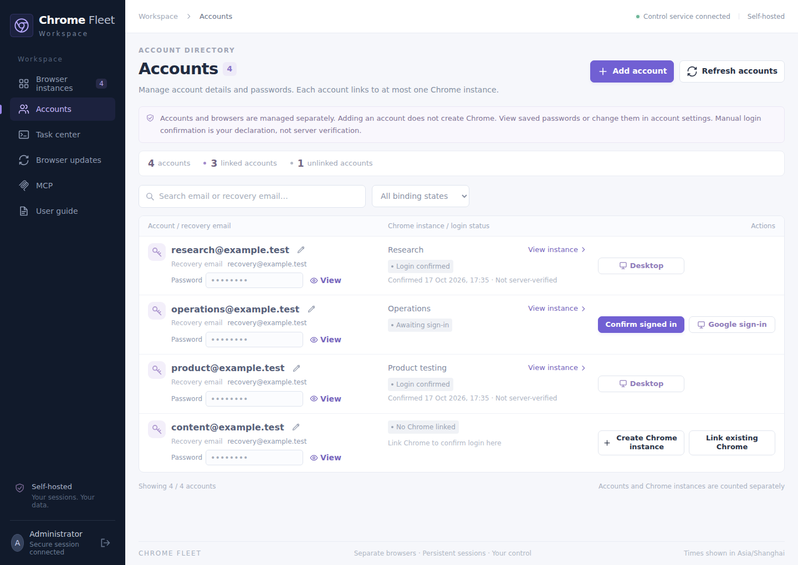
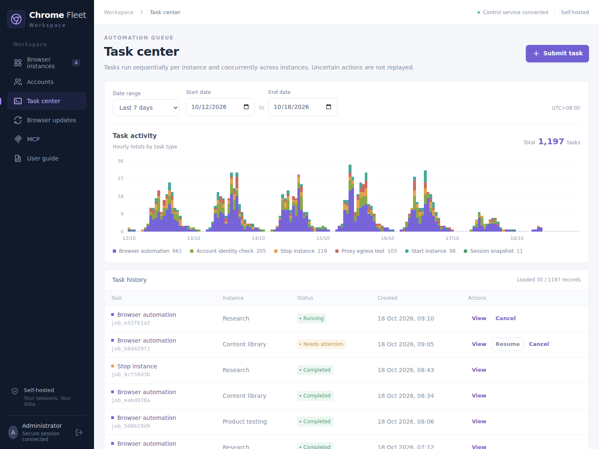
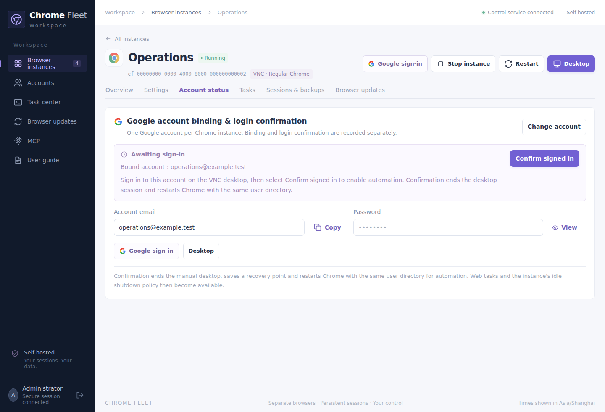
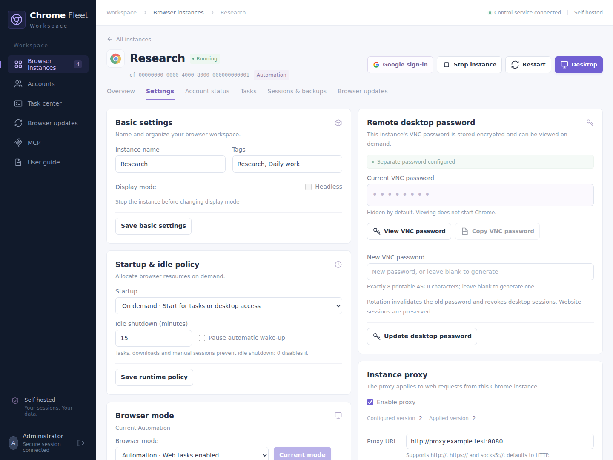
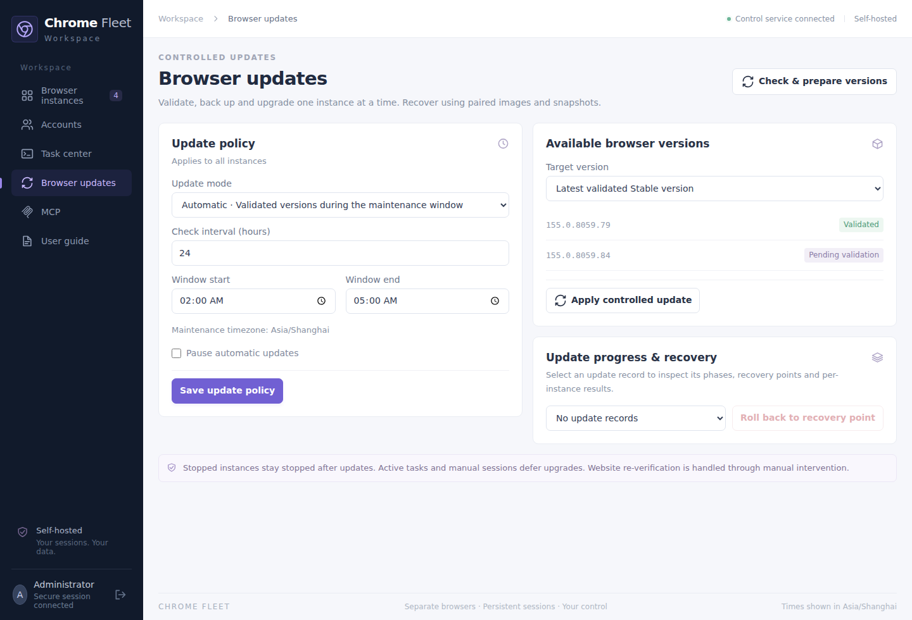
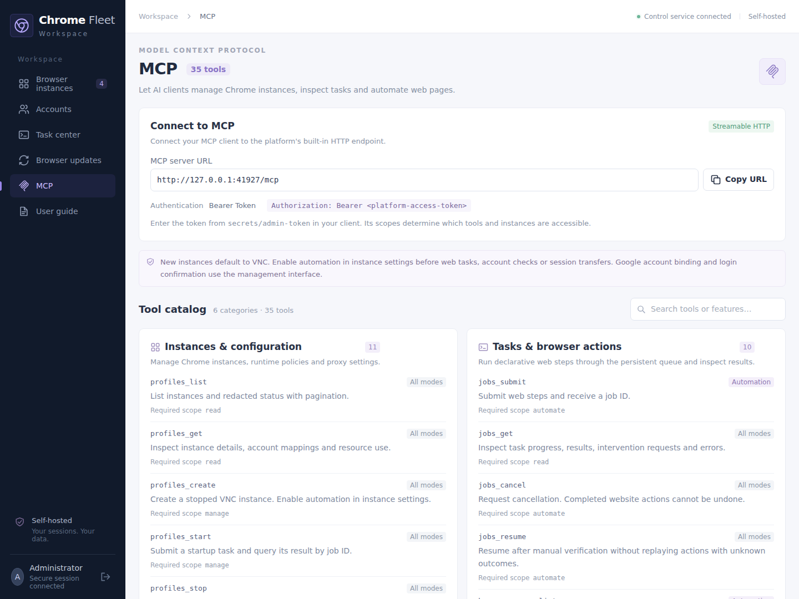
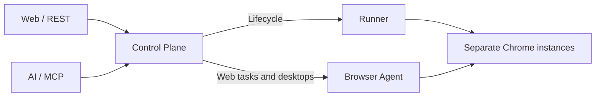

<p align="center">
  <a href="README.md">简体中文</a> · <strong>English</strong>
</p>

<p align="center">
  
</p>

<p align="center">
  <a href="LICENSE"></a>
  <a href="package.json"></a>
  <a href="package.json"></a>
  <a href="apps/web/package.json"></a>
  <br />
  <a href="apps/browser-agent/package.json"></a>
  <a href="compose.yaml"></a>
  <a href="docs/mcp.md"></a>
  <a href="#install-the-chrome-fleet-skill"></a>
  <a href="#deployment-and-quick-start"></a>
</p>

<p align="center">
  <a href="#product-overview">Overview</a> ·
  <a href="#screenshots">Screenshots</a> ·
  <a href="#deployment-and-quick-start">Deployment</a> ·
  <a href="#install-the-chrome-fleet-skill">Skill setup</a> ·
  <a href="#browser-automation-with-mcp">MCP usage</a> ·
  <a href="#stack-and-architecture">Stack</a> ·
  <a href="#documentation">Documentation</a> ·
  <a href="#license-and-third-party-notices">License</a>
</p>

**Chrome Fleet is a self-hosted browser workspace.** Keep a separate Chrome environment for each account, and manage accounts, proxies, remote desktops and tasks in a Chinese-language dashboard. Use the [Chrome Fleet Skill](#install-the-chrome-fleet-skill) to deploy or connect the service from **Codex or Claude Code**. After signing in to a website and enabling automation, use natural language to select an account's browser and perform web tasks.

Account records, browser user directories and backups stay on your server. Open a desktop to work directly, or run tasks through MCP or REST and take over when a website needs login verification.

## Product overview

| What you want to do | What Chrome Fleet provides |
| --- | --- |
| Manage multiple browser environments | Separate Chrome instances, user directories, proxies and desktop passwords, with on-demand startup and idle shutdown |
| Sign in and manage accounts | An account directory, email and password viewing/copying, Google account binding and manual login confirmation; confirmed accounts open their desktop directly |
| Connect an AI client | A Skill that guides deployment or reuses an existing service, and registers MCP for Codex / Claude Code |
| Let AI use a specific account | MCP tools select an instance to navigate, click, fill forms, extract text, take screenshots and run multi-step tasks |
| Take over a browser at any time | Remote desktops in a new window or embedded view, with bidirectional UTF-8 clipboard support |
| Monitor activity and resource use | Host and per-instance CPU and memory metrics, task progress, results and history |
| Preserve and restore sessions | Encrypted session exports, full snapshots taken while stopped, backups before upgrades, and rollback using paired images and snapshots |

[](docs/images/screenshots/en/browser-workspace.png)

*The workspace shows host resources in the upper-right corner. Each card displays its Chrome instance's status, resource use and desktop controls.*

### Ask your agent to install it

Copy this prompt into Codex or Claude Code to install the Skill:

```text
Install the Chrome Fleet Skill for the AI client I am currently using.
Repository: https://github.com/Scisaga/chrome-fleet
Skill directory: skills/chrome-fleet

Read SKILL.md and references/setup.md in that directory first. Check that Python 3.10+
and the current client's CLI are available. Use the bundled scripts/fleet_skill.py install
command to install the Skill for my current user, then use the installed copy for further steps.
Tell me where it was installed and what information is still needed to connect the MCP service.
```

To deploy or connect the service as well, append the following. Replace `fleet-host` with a configured SSH host alias; for a local Linux deployment, change the target to "this machine".

```text
Also connect Chrome Fleet on the SSH host fleet-host. Reuse an existing service if available;
otherwise, perform an initial deployment following the project's instructions.
Use the installed Skill to register MCP for my current client and verify the connection.
Tell me whether I need to reload the session, and provide the management interface URL.
```

See [Install the Chrome Fleet Skill](#install-the-chrome-fleet-skill) for commands and platform requirements. Once connected, try: "Use the browser associated with sales@example.test to open https://example.com and extract the title."

## Screenshots

These English documentation previews use the actual frontend with localized demo labels and synthetic data. The deployed dashboard currently uses Chinese. Passwords remain masked. Click an image to view it at full size.

### Account management

View account emails, recovery emails, associated instances and login confirmation status. Confirmed accounts show an **Open desktop** action; accounts awaiting confirmation retain their login action.

[](docs/images/screenshots/en/account-directory.png)

### Task center

Inspect task states, hourly task distribution and execution records. Filter by time range and open a task to review its progress and results.

[](docs/images/screenshots/en/task-center.png)

<details>
<summary>More screenshots: account login, instance settings and browser updates</summary>

### Account binding and login confirmation

View and copy the bound account's email and password, open its desktop to sign in, then confirm the login and enable automation.

[](docs/images/screenshots/en/account-login.png)

### Instance settings

Configure each instance's browser mode, startup policy, resources and network proxy, and view or manage its desktop password.

[](docs/images/screenshots/en/instance-settings.png)

### Controlled browser updates

Validate a candidate version, back up the instances, then upgrade them one at a time. Review each instance's result and roll back using its paired recovery point when needed.

[](docs/images/screenshots/en/browser-updates.png)

</details>

## Deployment and quick start

You need **Linux x86_64, Docker Engine (rootful), Docker Compose and Python 3**. Start Docker and make sure your current user can access it. The host must provide `iptables`, `iptables-restore`, `flock` and the `DOCKER-USER` chain.

```bash
git clone https://github.com/Scisaga/chrome-fleet.git
cd chrome-fleet
sudo ./scripts/fleet init
sudo ./scripts/fleet firewall
docker compose --profile build build
docker compose up -d
sudo ./scripts/fleet doctor
```

The first `init` creates `.env` and a separate data directory. The default management URL is **http://127.0.0.1:8080**, and the data directory is `/var/lib/chrome-fleet`.

For the first login, use the **platform token file** whose path is printed during initialization. Its default location is:

```text
/var/lib/chrome-fleet/secrets/admin-token
```

Read this file locally on the server and enter the token on the login page. If you change `FLEET_DATA_ROOT`, the token path changes accordingly.

To access the service from another device, configure `FLEET_BIND_ADDRESS`, `FLEET_PUBLIC_URL` and `FLEET_ALLOWED_ORIGINS` in `.env` after initialization and before starting the service. See [Deployment and operations](docs/operations.md) for configuration, HTTPS, firewall restoration after reboot and troubleshooting.

### Start with your first account

1. In account management, add an existing account's email, password and optional recovery email.
2. Choose **Create Chrome instance** on that account's row, then configure its name, proxy and resources.
3. New instances use regular Chrome / VNC mode by default. Open the Google login desktop and complete sign-in and verification manually.
4. Return to account status or account management and choose **Confirm logged in**. The system saves a recovery point and switches to automation using the same user directory.
5. For daily use, choose **Open desktop**, or submit web tasks to this instance through MCP.

Account binding, manual confirmation and the website's actual login state are recorded separately. Initial login, CAPTCHAs and two-factor authentication require human interaction. Preserving the user directory does not guarantee that a website will never ask you to sign in again. See [Account login and session recovery](docs/session-recovery.md#google-人工登录与实例绑定) for details.

## Browser automation with MCP

MCP is built into the management service. With Streamable HTTP, connect directly using the settings below; no extra MCP process is needed. The Skill uses a stdio bridge to the same service, supports SSH hosts and keeps the token on the server.

| Setting | Value |
| --- | --- |
| Transport | Streamable HTTP |
| Server URL | `http://127.0.0.1:8080/mcp`; for remote deployments, use the actual management URL followed by `/mcp` |
| Authentication | Bearer Token |
| Token | The platform access token used for the management interface, or a separate token restricted to specific instances and scopes |

If your client accepts request headers, set `Authorization: Bearer <platform-access-token>`.

The **MCP** page in the dashboard sidebar lets you copy the server URL and search **35 tools across 6 categories**, with descriptions and required permissions.

[](docs/images/screenshots/en/mcp-integration.png)

### Select a browser by account

Once connected, ask your AI client:

> Find the Chrome instance associated with sales@example.test, open https://example.com and extract the page title. Operate only that account's instance and return the result when finished.

The corresponding tool flow is:

1. Page through `profiles_list` and match the account using `googleBinding.email` or `accounts[].expectedIdentity`.
2. Use `profiles_get` to confirm the target `profileId`, browser mode and account record.
3. Use single-step tools such as `browser_navigate`, `browser_click`, `browser_fill` and `browser_extract`, or submit multiple steps with `jobs_submit`.
4. Query progress and results with `jobs_get`, using the returned `jobId`.

Web automation requires the target instance to be in **automation mode**. Tools keep using that instance's user directory and website sessions. If a human session is active, finish the manual work and end the takeover before continuing automation.

### Simple example: open a page and extract its heading

The following JSON is the `params` object for an MCP `tools/call` request, sent by an already connected client. You can also use the natural-language prompt above and let the AI make the calls. All IDs below are examples; replace them with values returned by the service.

```json
{
  "name": "jobs_submit",
  "arguments": {
    "profileId": "cf_00000000-0000-4000-8000-000000000001",
    "steps": [
      { "action": "goto", "url": "https://example.com" },
      { "action": "extractText", "locator": { "css": "h1" } }
    ],
    "timeoutMs": 60000
  }
}
```

After submission, query the returned `jobId`:

```json
{
  "name": "jobs_get",
  "arguments": {
    "jobId": "job_00000000-0000-4000-8000-000000000002"
  }
}
```

To check the target account's identity before execution, add `expectedAccountId` to `jobs_submit` or a single-step browser tool. Use the target instance's `accounts[].id`. This differs from `googleBinding.accountId` in the account directory binding; the IDs are not interchangeable. If the identity cannot be confirmed, the task waits for human intervention.

### Common operations

| Goal | Example tools |
| --- | --- |
| Inspect, start or stop a specific Chrome instance | `profiles_list`, `profiles_get`, `profiles_start`, `profiles_stop` |
| Browse and interact with pages | `browser_navigate`, `browser_click`, `browser_fill`, `browser_extract`, `browser_screenshot` |
| Run a sequence and inspect its result | `jobs_submit`, `jobs_get` |
| Take over for verification and resume a waiting task | `manual_session_open`, `manual_session_close`, `jobs_resume` |
| Export a session or create a recovery point | `cookies_export`, `storage_state_export`, `profiles_backup` |

Tools enforce the token's scopes and allowed instances. Browser operations return task IDs; disconnecting MCP does not cancel submitted tasks. If an outcome is unknown, inspect the actual page before repeating an action. Enter website passwords, verification codes and two-factor authentication through the manual desktop.

The current MCP integration uses Bearer authentication for local use and explicitly authorized LAN / WireGuard access. It does not yet provide a full public OAuth flow. See the [MCP guide](docs/mcp.md) for the full tool list, client code and optional stdio setup.

## Install the Chrome Fleet Skill

The [`chrome-fleet` Skill](skills/chrome-fleet/SKILL.md) covers initial deployment, MCP setup and daily account-specific browser tasks in one workflow. It supports **Codex and Claude Code** on Linux, macOS, WSL and native Windows clients. macOS and Windows clients connect to a Linux service over SSH.

Prepare **Python 3.10+** and the relevant AI client's CLI. Remote use also requires OpenSSH, configured SSH keys and verified host keys. The client does not need Node.js.

From a source checkout, install the Skill for `codex`, `claude` or `both`:

```bash
python3 skills/chrome-fleet/scripts/fleet_skill.py install --client codex
```

Use the **installed copy** for setup so that MCP configuration does not depend on your source checkout. For Codex on a local Linux host:

```bash
python3 ~/.agents/skills/chrome-fleet/scripts/fleet_skill.py setup --client codex --target local
```

For Claude Code with a remote SSH host, replace `fleet-host` with your SSH host alias:

```bash
python3 skills/chrome-fleet/scripts/fleet_skill.py install --client claude
python3 ~/.claude/skills/chrome-fleet/scripts/fleet_skill.py setup --client claude --target ssh --ssh-host fleet-host
```

On native Windows, install with `py -3` from the source checkout in PowerShell, then run the installed copy:

```powershell
py -3 .\skills\chrome-fleet\scripts\fleet_skill.py install --client codex
py -3 "$HOME\.agents\skills\chrome-fleet\scripts\fleet_skill.py" setup --client codex --target ssh --ssh-host fleet-host
```

`setup` first detects and reuses an existing service. Fresh deployments support Ubuntu 22.04/24.04/26.04 LTS and Debian 12/13 on amd64, with systemd, rootful Docker and root or non-interactive sudo access. Setup installs missing dependencies, uses a pinned service commit and validates the runtime with a temporary empty Chrome profile. It does not initialize, upgrade or restart an existing service.

MCP is registered for your current user, preserving other server configurations. Follow the output to reload the client session before use. Windows and WSL require separate registrations. Connection metadata is stored under `~/.chrome-fleet/skill/` without token values. SSH connections use existing server-side credentials, defaulting to the same administrator identity as the management interface.

After setup, try:

> Use chrome-fleet to find the browser associated with sales@example.test, open https://example.com and extract its main heading. Operate only that account, and return the result after checking that the task has completed.

Complete manual login or verification in the same instance's desktop, end the human session, then continue the original task. The management interface and MCP must use the same platform credential identity. To diagnose a connection or open the management interface:

```bash
python3 ~/.agents/skills/chrome-fleet/scripts/fleet_skill.py doctor --name chrome-fleet
python3 ~/.agents/skills/chrome-fleet/scripts/fleet_skill.py desktop --name chrome-fleet
```

For SSH targets, `desktop` keeps a forwarding connection open in the foreground; Ctrl+C closes only that tunnel. `doctor` performs diagnostics by default. Add `--runtime` explicitly to create a temporary empty browser for validation. See [Skill setup](skills/chrome-fleet/references/setup.md), [Account-specific browser tasks](skills/chrome-fleet/references/usage.md) and [Troubleshooting](skills/chrome-fleet/references/troubleshooting.md) for parameters and workflows.

## Stack and architecture

Chrome Fleet is designed for self-hosting on a single Linux machine. The dashboard, REST API and MCP share account permissions and a persistent task queue.

| Layer | Technology | Responsibility |
| --- | --- | --- |
| Dashboard | React 19 · Vite 7 · TypeScript 5.9 | Accounts, instances, remote desktops and tasks |
| Control service | Node.js 24 LTS · Fastify 5 | Authentication, instance authorization, task orchestration and update scheduling |
| AI integration | MCP SDK 1.32 · Streamable HTTP / stdio | 35 tools using the same REST permissions and queue |
| Browser and desktop | Chrome · Playwright 1.64 · noVNC | Manual desktops in regular Chrome and switching to automation mode |
| Persistence | SQLite WAL · AES-256-GCM | Task state, account directory, encrypted credentials and backups |
| Runtime and isolation | Docker Compose · Linux x86_64 | Instance lifecycle, separate user directories and network rules |



See [Architecture and versions](docs/architecture.md) for component relationships, pinned dependencies and the data layout.

## Documentation

The detailed operational guides linked below are currently in Chinese. The Skill's main instructions are in English, with additional setup and usage references in Chinese.

| Document | Contents |
| --- | --- |
| [Deployment and operations](docs/operations.md) | Installation, remote access, HTTPS, proxy networking, clipboard support and troubleshooting |
| [MCP guide](docs/mcp.md) | HTTP connections, authentication, tool permissions, client code and stdio |
| [Chrome Fleet Skill](skills/chrome-fleet/SKILL.md) | Codex / Claude Code installation, service deployment and connection, account selection and human takeover |
| [REST API and TypeScript SDK](docs/api.md) | APIs, asynchronous tasks, idempotency and code examples |
| [Account login and session recovery](docs/session-recovery.md) | Manual login, account confirmation, cookies, website storage and full snapshots |
| [Architecture and versions](docs/architecture.md) | Components, data directories, pinned dependencies and runtime behavior |
| [Validation records](docs/validation.md) / [UI validation](docs/validation-ui.md) | Completed checks, acceptance records and current limitations |
| [Project logo](docs/images/brand/logo.svg) / [Product banner](docs/images/brand/hero.en.svg) | SVG brand assets matching the management interface |

<details>
<summary>Local development and documentation maintenance</summary>

Local development uses Node.js 24. See the lockfile and architecture guide for dependency versions.

```bash
npm ci
npm run build
npm test
```

`npm run dev` starts the control service; initialize runtime data and prepare the Runner and browser image first. For frontend development, run `npm run dev -w @chrome-fleet/web`.

The Skill uses the Python standard library. Run its isolated tests without starting Docker, connecting real accounts or installing AI clients:

```bash
python3 -W error::ResourceWarning -m unittest discover -s skills/chrome-fleet/tests -v
```

GitHub Actions runs client helper checks on Linux, macOS and Windows. Actual service deployment and Chrome runtime validation require separate, dedicated Ubuntu/Debian hosts; isolated tests do not replace that validation.

README screenshots use the actual frontend and separate synthetic data. They do not connect to running accounts or browsers:

```bash
npm run build -w @chrome-fleet/web
node scripts/capture-readme-screenshots.mjs
```

The screenshot script requires Chromium, its system dependencies and fonts that support Chinese. Set `FLEET_QA_CHROME` to select a Chrome executable. It generates Chinese screenshots under `docs/images/screenshots/` and English documentation previews under `docs/images/screenshots/en/`. Preview labels are localized for the documentation; the deployed dashboard currently uses Chinese.

See [BUILD_PROMPT.md](BUILD_PROMPT.md) for the original requirements.

</details>

## License and third-party notices

This project is licensed under the [Apache License 2.0](LICENSE), with copyright notices in [NOTICE](NOTICE). It permits commercial use, modification and distribution, and includes an express patent grant. Redistribution requires preserving the license and applicable notices and identifying modified files.

Third-party dependencies and assets retain their own licenses and copyright notices:

- [MCP logo: MIT license and source](apps/web/public/notices/mcp-logo.txt).
- [DejaVu Sans Mono: Bitstream Vera / DejaVu license](apps/web/public/fonts/dejavu-sans-mono.LICENSE.txt).

Google Chrome, noVNC and other third-party components are governed by their respective licenses.
