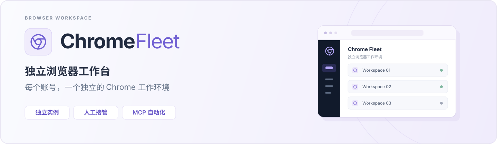
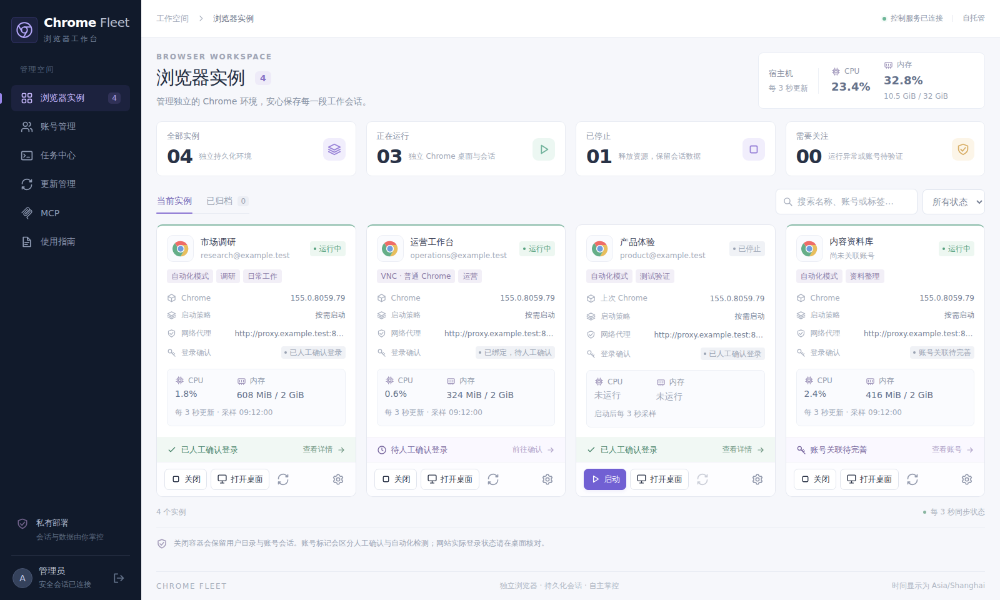
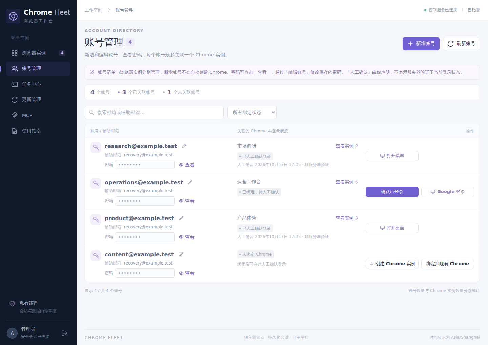
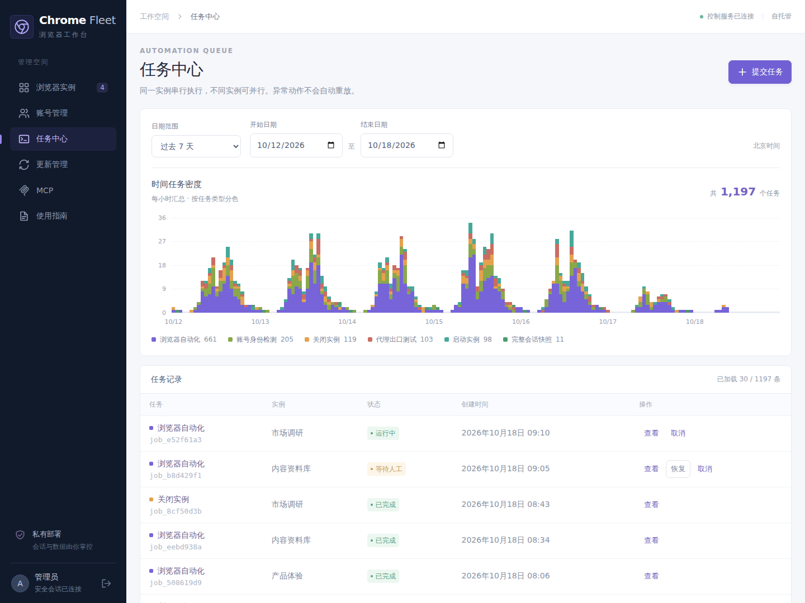
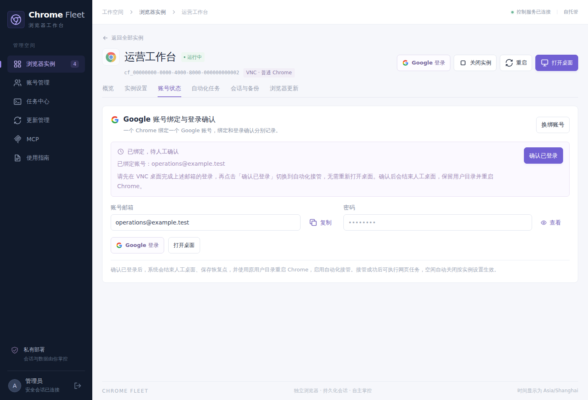
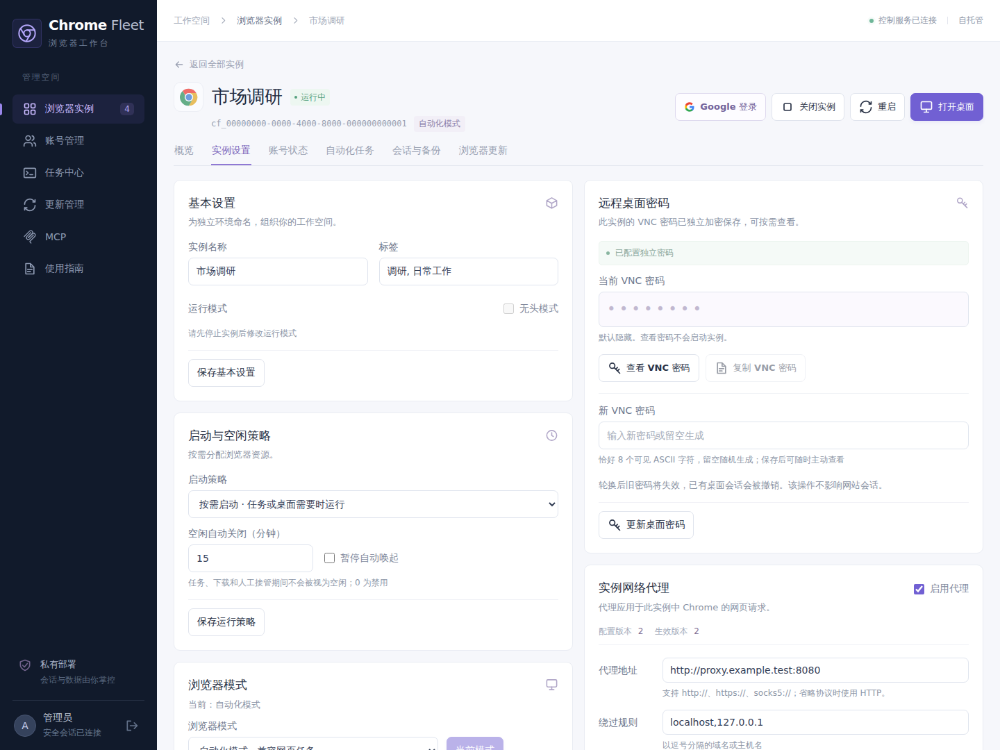
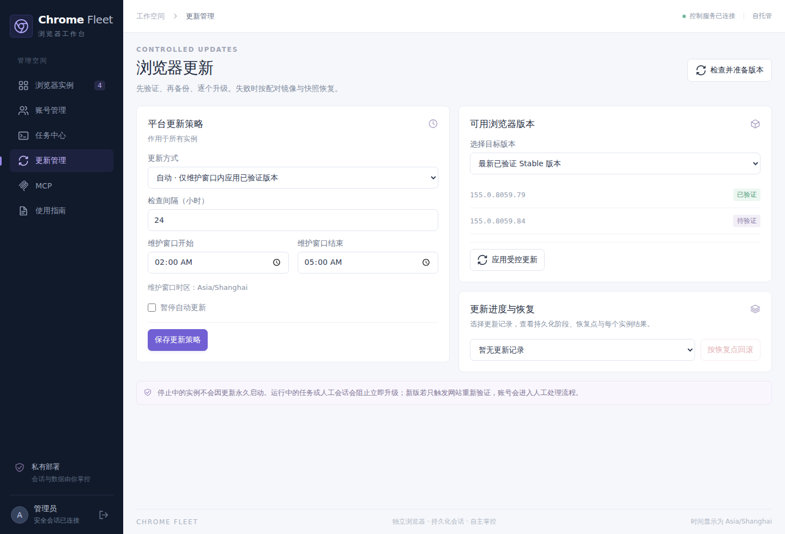
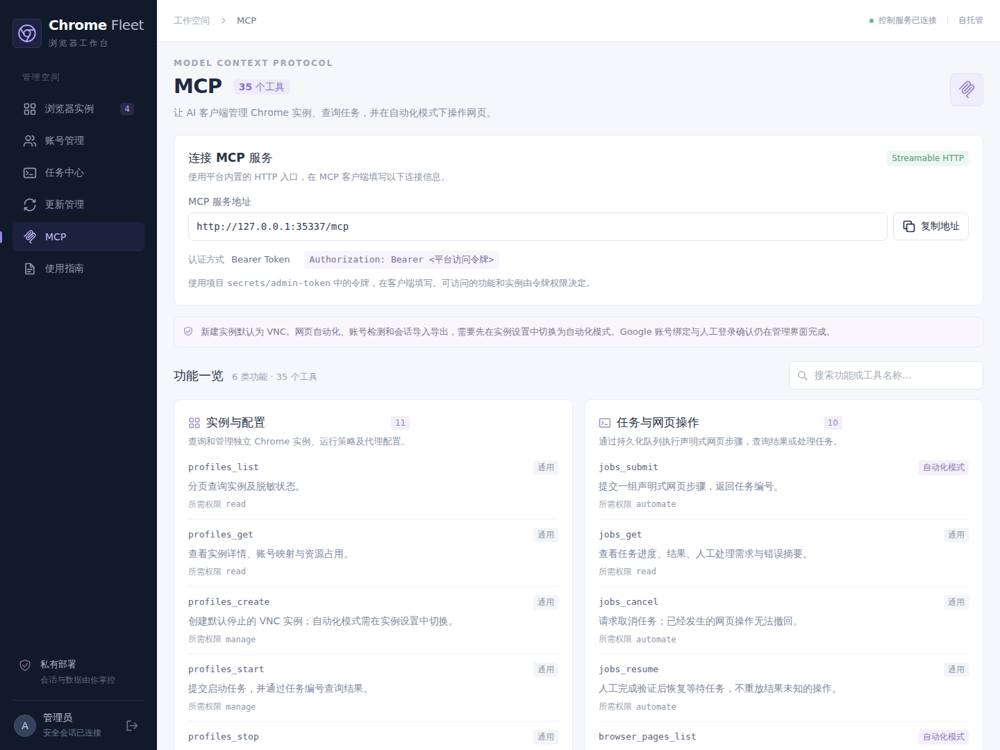
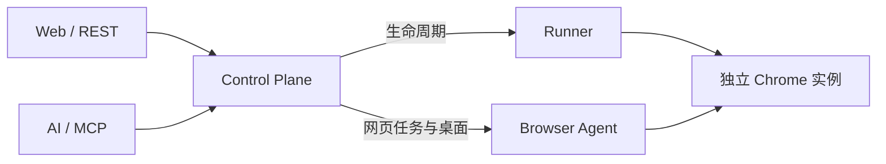

<p align="center">
  
</p>

<p align="center">
  <a href="LICENSE"></a>
  <a href="package.json"></a>
  <a href="package.json"></a>
  <a href="apps/web/package.json"></a>
  <br />
  <a href="apps/browser-agent/package.json"></a>
  <a href="compose.yaml"></a>
  <a href="docs/mcp.md"></a>
  <a href="#安装-chrome-fleet-skill"></a>
  <a href="#部署与快速开始"></a>
</p>

<p align="center">
  <a href="#产品概览">产品概览</a> ·
  <a href="#界面预览">界面预览</a> ·
  <a href="#部署与快速开始">部署与快速开始</a> ·
  <a href="#安装-chrome-fleet-skill">Skill 接入</a> ·
  <a href="#通过-mcp-让-ai-操作浏览器">MCP 用法</a> ·
  <a href="#技术栈与架构">技术栈</a> ·
  <a href="#更多文档">更多文档</a> ·
  <a href="#许可证与第三方声明">License</a>
</p>

**Chrome Fleet 是一个自托管的浏览器工作台。** 为不同账号保留独立的 Chrome 环境，在中文界面中管理账号、代理、远程桌面和任务。通过 [Chrome Fleet Skill](#安装-chrome-fleet-skill)，在 **Codex 或 Claude Code** 中部署或接入服务；完成网站登录并启用自动化后，用自然语言选择指定账号的浏览器，执行网页操作。

账号资料、浏览器用户目录和备份保存在你管理的服务器上。既可以打开桌面亲自操作，也可以通过 MCP 或 REST 执行自动化任务，遇到登录验证时再人工接管。

## 产品概览

| 你想做什么 | Chrome Fleet 提供什么 |
| --- | --- |
| 管理多个浏览器环境 | 独立 Chrome 实例、用户目录、代理和桌面密码，按需启动与空闲关闭 |
| 方便地登录和使用账号 | 账号目录、邮箱和密码查看/复制、Google 账号绑定与人工登录确认；已确认账号直接打开桌面 |
| 接入 AI 客户端 | Skill 引导部署或复用服务，自动配置 Codex / Claude Code 的 MCP 连接 |
| 让 AI 操作指定账号 | MCP 按实例选择浏览器，执行导航、点击、表单填写、文本提取、截图及多步任务 |
| 随时接手浏览器 | 新窗口或内嵌远程桌面，支持中文等 UTF-8 文本的双向剪贴板 |
| 看清运行情况 | 宿主机与各实例的 CPU、内存用量，任务进度、执行结果和历史记录 |
| 保留和恢复工作环境 | 加密会话导出、完整停机快照、升级前备份，以及旧镜像与快照配对回滚 |

[](docs/images/screenshots/browser-workspace.png)

*实例总览：右上角查看宿主机资源，每张卡片显示对应 Chrome 的状态、资源用量和桌面入口。*

## 界面预览

以下截图由当前前端生成，使用示例账号和演示数据，密码保持遮挡。点击图片可查看原图。

### 账号管理

集中查看邮箱、辅助邮箱、关联实例与登录确认状态。已确认登录的账号显示“打开桌面”，未确认账号保留登录入口。

[](docs/images/screenshots/account-directory.png)

### 任务中心

查看任务状态、历史密度和执行记录，按时间范围定位操作，继续查看对应任务的进度与结果。

[](docs/images/screenshots/task-center.png)

<details>
<summary>查看更多界面：账号登录、实例设置与浏览器更新</summary>

### 账号绑定与登录确认

在实例页查看、复制已绑定邮箱和密码，进入桌面完成登录，再确认并启用自动化接管。

[](docs/images/screenshots/account-login.png)

### 实例设置

按实例调整浏览器模式、启动策略、资源与网络代理，查看或管理远程桌面密码。

[](docs/images/screenshots/instance-settings.png)

### 浏览器受控更新

先验证候选版本，再备份并逐个升级。查看每个实例的升级结果，必要时按配对恢复点回滚。

[](docs/images/screenshots/browser-updates.png)

</details>

## 部署与快速开始

需要 **Linux x86_64、Docker Engine（非 rootless）、Docker Compose 和 Python 3**。先启动 Docker，并确保当前用户有 Docker 访问权限；宿主需提供 `iptables`、`iptables-restore`、`flock` 和 `DOCKER-USER` 链。

```bash
git clone https://github.com/Scisaga/chrome-fleet.git
cd chrome-fleet
sudo ./scripts/fleet init
sudo ./scripts/fleet firewall
docker compose --profile build build
docker compose up -d
sudo ./scripts/fleet doctor
```

首次 `init` 会创建 `.env` 和独立的数据目录。默认管理地址是 **http://127.0.0.1:8080**，数据目录是 `/var/lib/chrome-fleet`。

首次登录使用初始化输出的**平台令牌文件**，默认位于：

```text
/var/lib/chrome-fleet/secrets/admin-token
```

在服务器本地读取该文件，将令牌填入登录页面。如果修改了 `FLEET_DATA_ROOT`，令牌路径随数据目录变化。

需要从其他设备访问时，在初始化后、启动服务前调整 `.env` 中的 `FLEET_BIND_ADDRESS`、`FLEET_PUBLIC_URL` 和 `FLEET_ALLOWED_ORIGINS`。完整配置、HTTPS、重启后的防火墙恢复与排错见[部署与运维](docs/operations.md)。

### 从第一个账号开始

1. 在“账号管理”新增已有账号的邮箱、密码和选填辅助邮箱。
2. 从该账号行点击“创建 Chrome 实例”，配置名称、代理及资源。
3. 新实例默认使用普通 Chrome / VNC。打开 Google 登录桌面，人工完成登录和验证。
4. 回到账号状态或账号管理，点击“确认已登录”。系统保存恢复点，使用原用户目录切换到自动化接管。
5. 日常使用时点击“打开桌面”，或通过 MCP 向这个实例提交网页任务。

账号绑定、人工确认与网站实际登录状态分别记录。首次登录、验证码和二次验证需要人工完成；保留用户目录也不保证网站永远不要求重新登录。详细流程见[账号登录与会话恢复](docs/session-recovery.md#google-人工登录与实例绑定)。

## 通过 MCP 让 AI 操作浏览器

MCP 已集成在管理服务中。使用 Streamable HTTP 时，直接填写以下信息，无需额外启动 MCP 进程；下方 Skill 接入则通过 stdio 桥接同一服务，支持 SSH 远端，令牌留在服务端。

| 配置项 | 填写内容 |
| --- | --- |
| 传输方式 | Streamable HTTP |
| 服务地址 | `http://127.0.0.1:8080/mcp`，远程部署时替换为实际管理地址加 `/mcp` |
| 认证方式 | Bearer Token |
| 令牌 | 与管理页面登录相同的平台访问令牌，也可使用限制了实例与权限的独立令牌 |

如果客户端使用请求头配置，填写 `Authorization: Bearer <平台访问令牌>`。

管理页面左侧的“MCP”提供服务地址复制、搜索以及 **6 类、35 个工具**的说明和权限标记。

[](docs/images/screenshots/mcp-integration.png)

### 按账号选择浏览器

连接后，可以对 AI 说：

> 找到 sales@example.test 对应的 Chrome，打开 https://example.com，提取页面标题。只操作这个账号对应的实例，完成后返回结果。

对应的调用流程是：

1. `profiles_list` 分页查询实例，根据 `googleBinding.email` 或 `accounts[].expectedIdentity` 找到账号绑定。
2. `profiles_get` 确认目标 `profileId`、浏览器模式和账号记录。
3. 使用 `browser_navigate`、`browser_click`、`browser_fill`、`browser_extract` 等单步工具，或用 `jobs_submit` 提交多步任务。
4. 根据返回的 `jobId`，通过 `jobs_get` 查询进度与结果。

网页自动化需要目标实例处于**自动化模式**。工具操作继续使用该实例的用户目录和网站会话；有人工接管时，先完成人工操作并结束接管，再继续自动化。

### 简单例子：打开网页并提取标题

以下 JSON 是 MCP `tools/call` 的 `params`，由已连接的客户端发送。也可以直接使用上面的自然语言指令，让 AI 完成这些调用。ID 均为示例，请替换为查询返回的实际值。

```json
{
  "name": "jobs_submit",
  "arguments": {
    "profileId": "cf_00000000-0000-4000-8000-000000000001",
    "steps": [
      { "action": "goto", "url": "https://example.com" },
      { "action": "extractText", "locator": { "css": "h1" } }
    ],
    "timeoutMs": 60000
  }
}
```

提交后取得 `jobId`，再查询执行结果：

```json
{
  "name": "jobs_get",
  "arguments": {
    "jobId": "job_00000000-0000-4000-8000-000000000002"
  }
}
```

需要在执行前检测目标账号身份时，为 `jobs_submit` 或单步网页工具增加 `expectedAccountId`，取目标实例的 `accounts[].id`。它与目录绑定中的 `googleBinding.accountId` 不同，不能互换；无法确认身份时，任务会等待人工处理。

### 常用操作

| 需求 | 工具示例 |
| --- | --- |
| 查询或启停指定 Chrome | `profiles_list`、`profiles_get`、`profiles_start`、`profiles_stop` |
| 浏览和操作网页 | `browser_navigate`、`browser_click`、`browser_fill`、`browser_extract`、`browser_screenshot` |
| 编排步骤、查看执行结果 | `jobs_submit`、`jobs_get` |
| 接手验证、恢复等待任务 | `manual_session_open`、`manual_session_close`、`jobs_resume` |
| 导出会话或创建恢复点 | `cookies_export`、`storage_state_export`、`profiles_backup` |

工具按令牌权限和实例范围校验。网页操作返回任务编号，断开 MCP 不会取消已提交任务；若结果未知，应先核查实际页面，避免重复提交。网站密码、验证码和二次验证通过人工桌面处理。

当前 MCP 使用适用于本机及显式授权 LAN / WireGuard 的 Bearer 模式，尚未提供完整公网 OAuth。完整工具表、客户端代码与可选 stdio 接入见 [MCP 使用文档](docs/mcp.md)。

## 安装 Chrome Fleet Skill

[`chrome-fleet` Skill](skills/chrome-fleet/SKILL.md) 将首次部署、MCP 配置和日常账号浏览器操作放在同一工作流中。支持 **Codex 与 Claude Code**，客户端可运行在 Linux、macOS、WSL 或原生 Windows；macOS、Windows 通过 SSH 连接 Linux 服务。

客户端先准备 **Python 3.10+**、对应 AI 客户端 CLI；远程使用还需 OpenSSH、已配置的 SSH 密钥和已核实的主机记录。无需在客户端安装 Node.js。

从源码目录安装 Skill，选择 `codex`、`claude` 或 `both`：

```bash
python3 skills/chrome-fleet/scripts/fleet_skill.py install --client codex
```

随后用**已安装副本**接入，避免 MCP 配置依赖源码目录。Codex 本机 Linux 示例：

```bash
python3 ~/.agents/skills/chrome-fleet/scripts/fleet_skill.py setup --client codex --target local
```

Claude Code 的 SSH 远端示例，`fleet-host` 替换为你的 SSH 主机别名：

```bash
python3 skills/chrome-fleet/scripts/fleet_skill.py install --client claude
python3 ~/.claude/skills/chrome-fleet/scripts/fleet_skill.py setup --client claude --target ssh --ssh-host fleet-host
```

原生 Windows PowerShell 在源码目录中使用 `py -3` 安装，然后运行已安装副本：

```powershell
py -3 .\skills\chrome-fleet\scripts\fleet_skill.py install --client codex
py -3 "$HOME\.agents\skills\chrome-fleet\scripts\fleet_skill.py" setup --client codex --target ssh --ssh-host fleet-host
```

`setup` 先识别并复用已有服务。新部署支持 Ubuntu 22.04/24.04/26.04 LTS、Debian 12/13 amd64，要求 systemd、rootful Docker 和 root 或免交互 sudo；会补齐缺失依赖，使用固定服务提交，并通过临时空白 Chrome 完成运行验收。已有服务不会被初始化、升级或重启。

配置自动注册到当前用户，保留其他 MCP 配置；按输出提示重新加载客户端会话后使用。Windows 与 WSL 需分别注册。连接元数据位于 `~/.chrome-fleet/skill/`，不保存 Token；SSH 接入使用服务端现有凭据，默认与管理页相同的管理员身份。

接入后可以对 AI 说：

> 使用 chrome-fleet，找到 sales@example.test 对应的浏览器，打开 https://example.com 并提取主标题。只操作这个账号，查询任务完成后返回结果。

需要人工登录或验证码时，在同一实例的桌面完成，结束人工接管后继续原任务。管理页与 MCP 应使用相同平台凭据。查看连接或打开管理入口：

```bash
python3 ~/.agents/skills/chrome-fleet/scripts/fleet_skill.py doctor --name chrome-fleet
python3 ~/.agents/skills/chrome-fleet/scripts/fleet_skill.py desktop --name chrome-fleet
```

`desktop` 为 SSH 目标维持前台转发；Ctrl+C 只关闭本次转发。`doctor` 默认只诊断，显式添加 `--runtime` 才创建空白验收浏览器。详细参数、人工接管与故障处理见 [Skill 安装接入](skills/chrome-fleet/references/setup.md)、[按账号操作](skills/chrome-fleet/references/usage.md)、[排错指南](skills/chrome-fleet/references/troubleshooting.md)。

## 技术栈与架构

面向 Linux 单机自托管，管理界面、REST 和 MCP 共用账号权限与持久任务队列。

| 层 | 技术 | 职责 |
| --- | --- | --- |
| 管理界面 | React 19 · Vite 7 · TypeScript 5.9 | 账号、实例、远程桌面和任务管理 |
| 控制服务 | Node.js 24 LTS · Fastify 5 | 身份认证、实例授权、任务编排与更新调度 |
| AI 接入 | MCP SDK 1.32 · Streamable HTTP / stdio | 向 AI 提供 35 个工具，复用 REST 的权限和队列 |
| 浏览器与桌面 | Chrome · Playwright 1.64 · noVNC | 普通 Chrome 人工桌面与自动化模式切换 |
| 持久化 | SQLite WAL · AES-256-GCM | 保存任务状态、账号目录及加密凭据与备份 |
| 运行与隔离 | Docker Compose · Linux x86_64 | 实例生命周期、独立用户目录与网络规则 |



组件关系、固定依赖版本与数据布局见[架构与版本](docs/architecture.md)。

## 更多文档

| 文档 | 内容 |
| --- | --- |
| [部署与运维](docs/operations.md) | 安装、远程访问、HTTPS、代理网络、桌面剪贴板与排错 |
| [MCP 使用文档](docs/mcp.md) | HTTP 连接、认证、工具权限、客户端代码与 stdio |
| [Chrome Fleet Skill](skills/chrome-fleet/SKILL.md) | Codex / Claude Code 安装、自动部署接入、指定账号操作与人工接管 |
| [REST API 与 TypeScript SDK](docs/api.md) | 接口、异步任务、幂等与代码示例 |
| [账号登录与会话恢复](docs/session-recovery.md) | 人工登录、账号确认、Cookie、网站存储及完整快照 |
| [架构与版本](docs/architecture.md) | 组件、数据目录、固定依赖版本及运行机制 |
| [验证记录](docs/validation.md) / [界面验证](docs/validation-ui.md) | 已覆盖的检查、验收记录与现有限制 |
| [项目 Logo](docs/images/brand/logo.svg) / [产品横幅](docs/images/brand/hero.svg) | 与管理界面一致的 SVG 品牌素材 |

<details>
<summary>本地开发与文档维护</summary>

本地开发使用 Node.js 24，具体依赖版本见锁文件与架构文档。

```bash
npm ci
npm run build
npm test
```

`npm run dev` 启动控制服务；需要先初始化运行数据并准备 Runner 与浏览器镜像。前端开发可运行 `npm run dev -w @chrome-fleet/web`。

Skill 使用 Python 标准库，可单独运行隔离测试，不需要启动 Docker、连接真实账号或安装 AI 客户端：

```bash
python3 -W error::ResourceWarning -m unittest discover -s skills/chrome-fleet/tests -v
```

GitHub Actions 在 Linux、macOS、Windows 上运行客户端辅助脚本检查；真实服务部署与 Chrome 运行时验收需另在专用 Ubuntu/Debian 主机执行，不能用这些隔离测试代替。

README 截图使用真实前端和独立的合成数据生成，不连接运行中的账号或浏览器：

```bash
npm run build -w @chrome-fleet/web
node scripts/capture-readme-screenshots.mjs
```

截图脚本需要可用的 Chromium、系统浏览器依赖及中文字体；也可通过 `FLEET_QA_CHROME` 指定 Chrome 可执行文件。生成结果位于 `docs/images/screenshots/`。

原始需求见 [BUILD_PROMPT.md](BUILD_PROMPT.md)。

</details>

## 许可证与第三方声明

本项目采用 [Apache License 2.0](LICENSE)，版权声明见 [NOTICE](NOTICE)。允许商业使用、修改与分发，并包含明确的专利授权条款；再分发时需保留许可证及适用声明，并标注修改。

第三方依赖和素材保留各自许可证及版权声明：

- [MCP Logo：MIT 许可及来源](apps/web/public/notices/mcp-logo.txt)。
- [DejaVu Sans Mono 字体：Bitstream Vera / DejaVu 许可](apps/web/public/fonts/dejavu-sans-mono.LICENSE.txt)。

Google Chrome、noVNC 和其他第三方组件的许可由各自项目提供。
