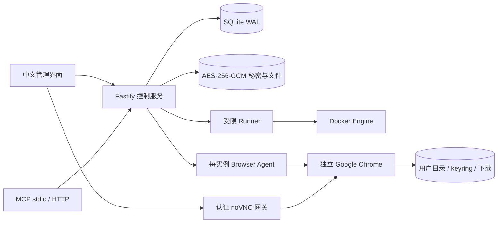

# 架构与边界

Chrome Fleet 面向 Linux x86_64 单机、单管理员、3–10 个持久浏览器。默认 Google Chrome Stable，新增实例以普通 Chrome 独立进程提供 VNC 桌面，不连接 Playwright/CDP；自动化兼容模式才使用 Playwright。两种模式使用每实例专用完整用户目录和 sandbox。没有共享浏览器进程或匿名 context 池。

REST、中文 React 界面和官方 MCP SDK 的 stdio / Streamable HTTP 最终使用同一控制服务、SQLite WAL 队列、权限检查和带 fencing token 的实例租约。stdio 是 API 客户端，不打开数据库。HTTP MCP 明确使用仍维护的 SDK v1 与 2025-11-25 协议；提供本机及显式允许的受信任 LAN/WireGuard Bearer 模式。公网 OAuth MCP 资源服务器尚未提供，不能直接把该入口暴露到公网。

## 固定技术版本

实际安装锁文件为准：Node.js 24.22.0 LTS、Playwright 1.64.1、Google Chrome 155.0.8059.79、MCP SDK 1.32.1、Fastify 5.12.7、React 19.2.0。依赖使用 npm workspaces，提交 package-lock.json。升级镜像记录实际版本与本机 Docker image ID（内容寻址 sha256）；该 ID 不声称是远端仓库签名。

核对来源：[Node LTS](https://nodejs.org/en/about/previous-releases)、[Playwright 持久上下文](https://playwright.dev/docs/api/class-browsertype#browser-type-launch-persistent-context)、[当前状态恢复 API](https://playwright.dev/docs/api/class-browsercontext#browser-context-set-storage-state)、[MCP v1 SDK](https://ts.sdk.modelcontextprotocol.io/server)、[Linux 密码存储](https://chromium.googlesource.com/chromium/src/+/HEAD/docs/linux/password_storage.md)。

## 存储与互斥

`FLEET_DATA_ROOT` 默认 `/var/lib/chrome-fleet`，包含 `db/`、`profiles/<id>/state/{chrome,keyrings,downloads,config}`、`profiles/<id>/secrets`、`vault/`、`artifacts/`、`backups/`、`tmp/`。实例 UID/GID 固定 1000。每个实例独立 D-Bus、gnome-keyring Secret Service、随机解锁秘密。启动先检查 keyring 解锁及 secret-tool probe，不接受 `--password-store=basic`。更新兼容测试还验证 Chrome 实际创建的 libsecret 密钥、sandbox 与容器重建后的 HttpOnly Cookie/IndexedDB。

数据库迁移由 `Store.migrate()` 事务执行，`migrations` 记录版本。`records` 保存独立实体集合，`leases` 与 `idempotency` 使用专门表和唯一约束；事务 `BEGIN IMMEDIATE` 原子领取租约。当前只支持单控制服务进程，不能横向扩容多个 worker 服务。

同一实例任务串行，不同实例按全局并发上限执行。人工接管持有相同租约。每个自动化步骤先持久化 inFlightStep，再调用 agent，完成后记录进度；控制服务中断的运行任务返回 `outcome_unknown`，不自动重放。租约提升会在 agent 拒绝旧 token，并等待旧操作结束；控制服务故障对账会停止尚可能执行旧任务的容器。手动停止持久化 `autoWakePaused`，不会被 always/on_demand 立即唤醒。

## 页面导航与字号

管理界面使用浏览器 History 路由，一级页面为 `/profiles`、`/accounts`、`/jobs`、`/updates` 和 `/guide`。界面仅通过账号创建实例，创建页使用 `/profiles/new?from=accounts&account=<accountId>`，固定关联所选账号，取消后返回账号管理；无有效账号 ID 的旧链接转到 `/accounts`。实例页使用 `/profiles/<profileId>/{overview,settings,accounts,tasks,sessions,updates}`，任务详情通过 `?job=<jobId>` 表示。刷新、直达和浏览器前进/后退通过相同路由恢复所选页面；页面 URL 不携带密码或平台令牌，资源访问仍由 API 校验权限。

左侧MCP菜单单独使用 `/integrations/mcp`，展示与服务端35个实际工具对照的六类目录、所需权限及模式限制，并提供当前origin下HTTP地址复制。`/mcp`保留给Streamable HTTP协议，管理页面不会向协议端点发送请求，也不读取或回填平台令牌。

实例卡片的账号入口统一依据 `googleBinding.confirmationState` 显示待人工确认或已人工确认，点击只进入账号状态页。浏览器模式与自动化检测结果不作为人工确认依据；自动化模式的账号页也显示持久确认记录及时间，未确认实例提供切回VNC完成确认的设置入口。

视觉样式在各组件及移动端覆盖中统一调整，正文15px、表单14px、按钮13–14px、辅助文字至少12px，标题保留清楚层级。功能图标使用24单位原生 SVG、圆头圆连接与一致笔画；Chrome 品牌图形保持独立。

工作区统一使用受控内容宽度（最大1440px）、24px桌面页边距、20px面板内边距与16px区块间距。表单标签至控件6px、字段行间距14px，可编辑输入与主要按钮统一40px高。设置和更新页最大1200px并与标题左边缘对齐，桌面采用两列独立卡片堆叠，避免短卡片下的大块空白；1100px以下改为单列，手机进一步收紧页边距并允许操作换行。实例卡片操作区在同排底部对齐，长邮箱、提示与标识允许断行；实时CPU/内存及人工确认功能继续保留。

## 实时资源用量

实例列表右上角通过 `GET /api/v1/host-metrics` 展示整台宿主机的 CPU 和内存占用。控制服务每3秒独立读取 Linux `/proc/stat` 和 `/proc/meminfo` 并在内存中缓存；容器统计读取缓慢时不阻塞宿主采样。CPU 按相邻样本的全部逻辑核心时间差计算，整机满载为100%，不重复累计 guest 时间；内存已用量采用 `MemTotal - MemAvailable`，同时显示百分比与已用/总量。[Linux 内核统计字段说明](https://www.kernel.org/doc/html/v6.13/filesystems/proc.html)。首帧 CPU 等待第二次采样，读取失败或超过12秒未更新时隐藏旧数值；接口要求 `read` 权限且不写数据库、不操作 Chrome。

控制服务独立每3秒向 Runner 读取运行实例的 Docker stats，最多4个并发且同轮不重叠。读取不会启动 Chrome、连接浏览器调试协议或续期用户活动；目录大小与 Agent 健康检查仍由原维护周期处理。实例列表与详情展示相同的 CPU 百分比、已用内存/容器上限以及采样时间。

CPU 使用同一容器启动周期的累计 CPU 时间差除以宿主单调时钟时间差，单核满载为100%，多核可超过100%；首帧及重启后的首帧等待下一次采样。内存按 [Docker stats 的 Linux 口径](https://docs.docker.com/reference/cli/docker/container/stats/)扣除可回收文件缓存：cgroup v1 使用 `total_inactive_file`，v2 使用 `inactive_file`，缺少有效缓存字段时使用原始用量。停止、读取失败或超过12秒未更新分别显示未运行、不可用或已过期，避免将旧值显示为实时用量。

## 权限与网络

仅 Runner 挂 Docker socket，且只操作已标记实例、固定路径、允许的浏览器镜像和网络；浏览器没有 socket、宿主网络、特权参数或其他实例数据。Docker socket 仍是高权限入口，受限 API 不能消除 Runner 被攻陷后的风险。

浏览器控制网段为 172.30.0.0/24，控制服务 .2、Runner .3，实例 .32–.250。每实例另有独立出站桥接网段 172.31.X.0/24，默认禁止跨实例通讯。宿主 CF-FLEET 规则阻止浏览器新连接到私网、宿主和云元数据；Runner 在每次启动前检查当前 boot 的 root 所有标记。浏览器 URL/DNS 过滤为额外限制，不替代防火墙。

代理端点的网络准入按 profile 来源地址、目标 IP、端口及 TCP/UDP 协议精确匹配，随代理保存、修改、禁用及实例启停和防火墙重载同步，不开放整个私网或其他实例的代理。`FLEET_ALLOWED_PROXY_ENDPOINTS` 仅保留旧部署的管理员兼容例外，正常实例配置不依赖此全局选项。浏览器代理版本加载与网络规则同步分别负责配置和准入；`appliedVersion` 不代表 TCP 可连或 HTTPS CONNECT 已成功。允许到代理端点的 UDP 数据报也不等于 HTTP 代理支持 UDP 中继，浏览器代理配置不构成 DNS/WebRTC 或全容器透明隧道。普通内网站点仍需要明确的网络与 URL 允许配置。

规则仅为当前运行的受管 profile 计算真实出站/控制接口及来源 IP，并匹配精确原始目标元组以处理 Docker 发布端口 DNAT；宿主 INPUT 中的代理入口也使用同样范围。域名每60秒解析 IPv4 A 记录，失败先撤回旧地址例外再标记 pending 重试；revision、profile版本及删除标记拒绝旧配置重新放行。停止时回收来源规则，跨 boot 不复用旧来源。固定 Runner 镜像中的短期 helper 仅获得宿主网络和 NET_ADMIN，用于受限规则安装，不挂载实例密码或平台凭据。

平台令牌以 SHA-256 摘要保存；可按 scope/profile/有效期创建、撤销和轮换。Web 使用 HttpOnly、SameSite=Strict Cookie、CSRF；HTTPS 配置必须开启 Secure。每次 artifact 下载、桌面 HTTP 资源和 WebSocket 都重新检查权限。VNCAuth 每实例独立8字符密码，加密保存在vault，有实例管理权限的用户可在设置页主动查看；每次查看核验主体、profile范围和Web CSRF并记录无秘密的审计，不缓存查看响应。受保护的 noVNC 客户端还可在本人有效人工会话中自动取得该密码完成 VNCAuth：单独核验 Web 登录、CSRF、automate/profile 范围、绑定会话和密码版本，密码只用于内存中的握手，不写入 HTML、URL 或浏览器持久存储。普通查询和 MCP 不返回密码，VNC 认证仍然启用。

VNC 模式每实例只绑定一个目录Google账号；管理员在账号管理或实例详情直接声明已完成登录，无需另开桌面租约。账号对应关系和最近人工确认时间由平台权限及Web CSRF保护，记录 `manually_confirmed/manual_confirmation`，不进行页面检测或读取账号密码；选择目录账号与确认绑定为两个操作。普通 Chrome 通过本地 HTTP/CONNECT 中继使用实例代理（含 HTTP 代理认证与无认证 SOCKS5）；目的地址先做 URL/DNS 私网检查；直连和显式bypass固定预检IP，经过用户配置的可信上游时保留网站域名，由上游负责域名解析与路由，失败不会回退直连。普通启动仅跳过Chrome首次设置页，不连接调试协议或修改页面自动化属性。关闭使用窗口管理器请求本 Chrome 进程正常退出，未确认退出则保留进程和中继，不声称已保存。模式切换通过持久队列执行正常停机、加密快照和同镜像重启；中断保留最新数据，不自动回滚。

仅自动化兼容模式的 Google 登录分步填写使用单独的受限 Agent 入口。管理员显式选择导入账号后，控制服务从vault读取凭据并沿当前人工租约直接发送，不创建含密码的普通任务；对外仅记录阶段和固定提示。Agent只操作本次打开的Google顶层登录页：填邮箱，等待人工提交邮箱步骤，核对密码页账号后填密码。它不会提交邮箱或密码、处理验证码或备用邮箱，页面和阶段状态也不持有密码；同一页面去重，避免覆盖人工输入。已登录身份检测与表单填写分开，填充完成不代表认证或绑定成功。

桌面剪贴板使用当前Web会话及人工租约保护的UTF-8桥接。面板主动读写经桌面网关和Agent送至实例自己的X11 CLIPBOARD，不经过旧RFB的Latin-1文本通道；双方限制128KiB文本，核验CSRF、来源、实例范围、租约和密码版本，不记录或持久保存剪贴板正文。局域网HTTP使用用户在文本框的粘贴和显式复制回退，安全上下文可使用系统复制API，不后台读取本机剪贴板。

## 更新

默认每天检查、上海时区 02:00–05:00 自动维护，UTC 存储。Google 源与 CfT 分开获取与构建：Google 通过已验证指纹的 apt 公钥和签名索引安装指定包；CfT 通过官方 HTTPS 发布数据下载，不编造官方未提供的校验和。

候选镜像必须在全新一次性 profile 上完成实际 sandbox/keyring/Cookie/LS/IndexedDB 往返及重建验证。升级逐实例取得租约、正常停机、加密快照后更换镜像；失败恢复旧镜像与升级前快照配对。原本停止的实例只记录 pendingImage，下次启动先快照；技术失败恢复旧状态。备份失败不会继续升级。快照恢复会舍弃恢复点后的本地状态。

控制服务与Runner另接管理服务出站网络，用于官方版本源、镜像registry鉴权和受控构建；浏览器不接此网络，浏览器访问这些私网仍受CF-FLEET阻断。
